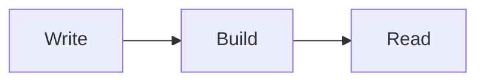

# Notes

A note site built from Markdown files. It has a sidebar, a calendar of
article dates, search, and diagrams, charts, API references and videos
inside articles.

Developers: see [DEVELOPERS.md](DEVELOPERS.md).

## Start the app

You need **Go 1.27** and **Node.js 24** (its bundled npm is enough).

```sh
npm install        # once
npm start          # builds everything and serves http://127.0.0.1:8080
```

Open http://127.0.0.1:8080. To see every feature on one page, open
http://127.0.0.1:8080/a/tour/index.

Stop the app with `Ctrl+C`.

### Commands at a glance

| Command                  | What it does                                                           |
| ------------------------ | ---------------------------------------------------------------------- |
| `npm start`              | Build everything and run the app at http://127.0.0.1:8080              |
| `npm run build:content`  | Rebuild after editing `content/`; a running app picks it up            |
| `npm run export`         | Write the static website to `static/` (and videos to `static-videos/`) |
| `npm run preview:static` | Check the exported website at http://127.0.0.1:4173                    |

## Where to write

Everything you write goes in the **`content/`** folder:

```
content/
  sidebar.json               the sidebar (categories and article links)
  aws/s3/s3.md               an article: any .md file in any folder
  aws/s3/img/bucket.png      images and other files used by the article
```

### Articles

Each article is a `.md` file. It can start with a short header (front
matter):

```markdown
---
title: S3 buckets
date: 2026-10-05
summary: How bucket policies work.
tags: [aws, storage]
draft: true
---

# S3 buckets

Your text in Markdown…
```

| Field     | Meaning                                    | If you leave it out                                                   |
| --------- | ------------------------------------------ | --------------------------------------------------------------------- |
| `title`   | Title shown on the page                    | The first `# Heading`, then the sidebar title, then the file name     |
| `date`    | Date in `YYYY-MM-DD`; the calendar uses it | Written automatically on the next build: the day the file was created |
| `summary` | Text shown in the day list and search      | The first paragraph                                                   |
| `tags`    | Labels shown under the title               | No tags                                                               |
| `draft`   | `true` keeps the article private           | Published                                                             |

**Dates are filled in automatically.** When an article has no `date`,
`npm start`, `npm run dev`, and `npm run build:content` write one into it
before building. They use the day the file was created (or last modified,
if the computer does not record creation times). Build a new article soon
after you create it to keep that day. You can edit any date afterwards.

**Drafts** (`draft: true`) are never shown anywhere: not in the sidebar,
search, calendar, or exported site. Remove the line to publish.

### Sidebar

Edit `content/sidebar.json`. Each entry has a `title` and a `path` (the
article file), `children` (more entries), or both. Entries can be nested as
deep as you like.

```json
[
  {
    "title": "AWS",
    "children": [
      { "title": "S3", "path": "aws/s3/s3.md" },
      {
        "title": "Networking",
        "children": [{ "title": "VPC", "path": "aws/vpc/vpc.md" }]
      }
    ]
  }
]
```

Articles that are not in the sidebar are still published and searchable.

## Prefixes in Markdown

Add diagrams, charts, API references and videos with these prefixes:

| You write                                 | You get                                             |
| ----------------------------------------- | --------------------------------------------------- |
| ``         | draw.io diagram (zoom and pages, read-only)         |
| ``  | Excalidraw drawing                                  |
| ``              | API reference from an OpenAPI 3 file (JSON or YAML) |
| ``          | API reference from a Swagger 2.0 file               |
| ``                  | video player (no autoplay)                          |
| a code block starting with ` ```mermaid ` | Mermaid diagram                                     |
| a code block starting with ` ```echarts ` | ECharts chart (write the chart option as JSON)      |

Examples:

````markdown


```echarts
{"xAxis": {"type": "category", "data": ["Mon", "Tue"]}, "yAxis": {"type": "value"}, "series": [{"type": "bar", "data": [3, 5]}]}
```
````

File paths:

- `files/x.drawio` is relative to the article's folder.
- `/aws/files/x.drawio` starts from `content/`.
- `drawio`, `excalidraw`, `openapi`, and `swagger` may also use an
  `https://` address. The file is downloaded when you build, so readers
  never contact that site.
- Videos must be local `.mp4` files.

Normal Markdown works too: tables, task lists, footnotes, code blocks with
highlighting, images (``), and links to other articles
(`[see this](../other/article.md)`).

## Build and output

After you change anything in `content/`, rebuild:

```sh
npm run build:content
```

| Output              | Where                                        | Used by                                                                                               |
| ------------------- | -------------------------------------------- | ----------------------------------------------------------------------------------------------------- |
| The built site data | `data/` (the newest build is `data/current`) | the running app. `npm start` and a running server pick up a new build automatically, with no restart. |

If the build finds a problem, it stops and tells you the file and the
reason (for example, a missing image or a bad date). The app keeps showing
the last good build.

### Export as a static website (for example GitHub Pages)

```sh
npm run export
```

This builds everything and writes two folders. Both are replaced on every
run.

| Output      | Where            | What to do with it                                                            |
| ----------- | ---------------- | ----------------------------------------------------------------------------- |
| The website | `static/`        | Upload or push it to your static host (for example a GitHub Pages repository) |
| Videos      | `static-videos/` | Upload these yourself to the address set in `NOTES_VIDEO_BASE_URL`            |

Settings (environment variables):

```sh
NOTES_BASE_PATH=/my-repo/ \
NOTES_VIDEO_BASE_URL=https://videos.example.com/ \
npm run export
```

- `NOTES_BASE_PATH`: the sub-path the site lives under, for example a
  GitHub Pages project site. The default is `/`.
- `NOTES_VIDEO_BASE_URL`: the address the videos will be served from. It is
  required when an article contains a video.
- The export stops if the site is larger than 1 GB or if any file is larger
  than 100 MB, because GitHub Pages and GitHub do not accept those.

**Check it locally** before uploading:

```sh
npm run preview:static     # http://127.0.0.1:4173 (use the same NOTES_BASE_PATH as the export)
```

Opening `static/index.html` directly as a file shows nothing. The site
loads its scripts and data by URL, so it must be served by a web server,
such as GitHub Pages or this preview.
