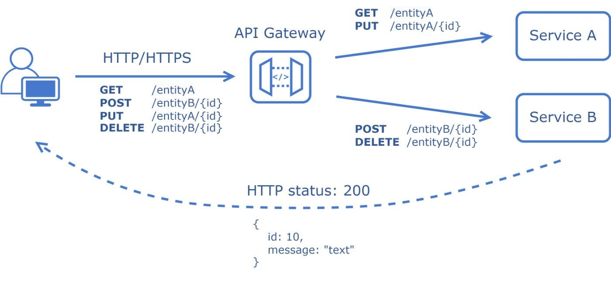
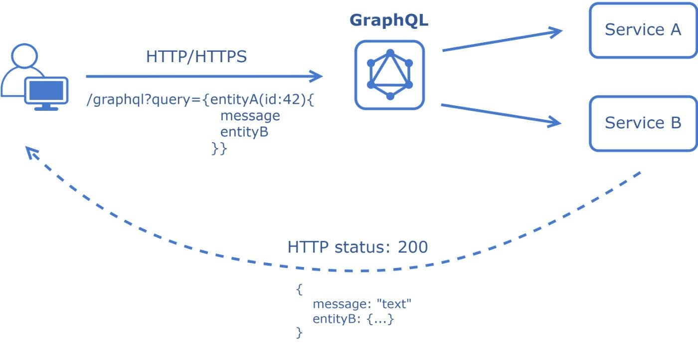
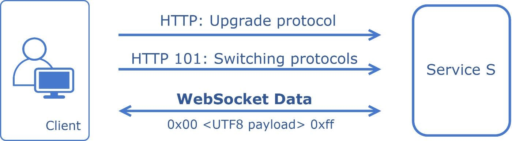
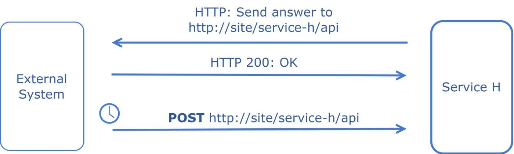
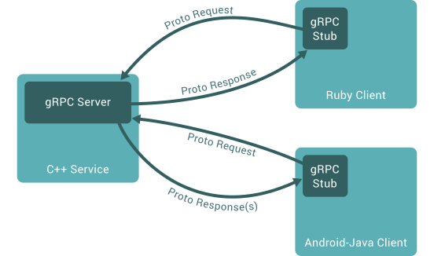
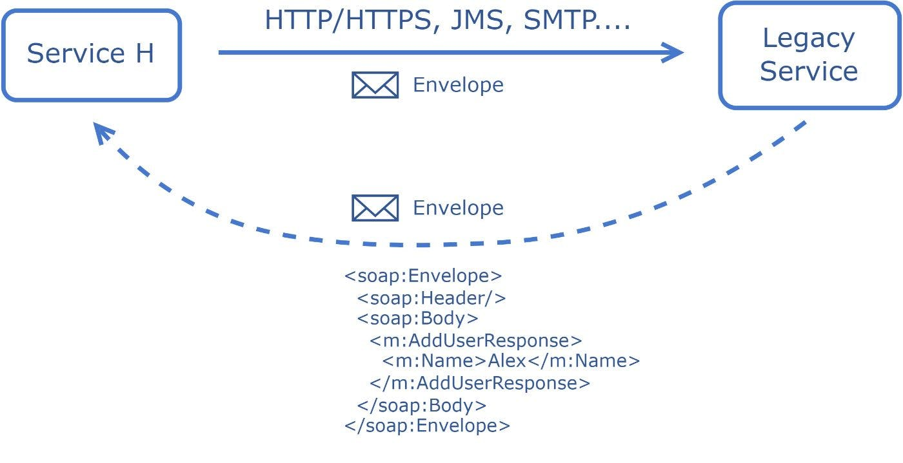

## API とは

Application Programming Interface (API) は、アプリケーション同士を繋ぐもの。

## REST(Representational State Transfer)

REST アーキテクチャスタイルに従う API は、REST API と呼ばれます。  
REST アーキテクチャを実装するウェブサービスは、RESTful ウェブサービスと呼ばれます。  
RESTful API という用語は、通常、RESTful web API を指します。

特徴

> すべてのリソースが一意の URI を持っている。  
> 統一されたインターフェス（GET POST PUT DELETE など、レスポンスは JSON）  
> ステートレス：サーバ側はクライアントの情報を持たない



Request

```text
GET “/user/42”
```

Response

```text
{
  "id": 42,
  "name": "Alex",
  "links": {
    "role": "/user/42/role"
  }
}
```

## GraphQL

Facebook(Meta)によって開発された。  
GraphQL は REST API よりも効率的にデータを取得できるため、パフォーマンスが向上する。  
GraphQL が単一のエンドポイントから必要なデータをまとめて取得できる。

> データの問い合わせ(Query)  
> データの作成、上書き、削除(Mutation)  
> データの変更をクライアントに通知(Subscription)



Request

```text
{
  hero {
    name
  }
}
```

Response

```text
{
  "data": {
    "hero": {
      "name": "R2-D2"
    }
  }
}
```

## WebSocket

双方向通信のプロトコル  
一度コネクションを確立したあとは、サーバとクライアントのどちらからも通信を行うことが可能  
一度コネクションを確立するとそのコネクション上で通信を行う(HTTP のように、通信のたびにコネクションを作らない)  
リアルタイムで更新が必要なアプリケーションで活用されている(チャットアプリ)  
頻繁にデータを更新できるので、HTTP よりも高速。



Request

```text
GET “ws://site:8181”
```

Response

```text
HTTP/1.1 101 Switching Protocols
```

## Webhook

アプリケーションの更新情報を他のアプリケーションへリアルタイム提供する仕組み  
イベント発生時、指定した URL に POST リクエストする仕組み  
例: Github、Slack の通知を Webhook で送る



Request

```text
GET “https://external-site/webhooks?url=http://site/service-h/api&name=name”
```

Response

```text
{
  "webhook_id": 12
}
```

## RPC(Remote Procedure Call)/gRPC

https://grpc.io/docs/quickstart/

gRPC は、HTTP/2 を利用する。  
gRPC は、Protocol Buffers(protobuf)シリアライゼーション形式を使用する。  
IDL（インターフェース定義言語）を使ってあらかじめ API 仕様を .proto ファイルとして定義し、そこからサーバー側＆クライアント側に必要なソースコードのひな形を生成する。
マイクロサービス間、モバイルアプリとバックエンドサーバ間の通信で用いられる



**gRPC の要素**

- RPC(Remote Procedure Call): RPC ベース

- Protocol Buffers(.proto): 言語中立のデータフォーマット、JSON と比べてバイナリ形式に変換されるため、データ量が小さく、高速転送が可能

- HTTP/2: HTTP/2 上に構築され、より高効率的な通信を可能

- 四つの通信方法

  1. Unary RPC: 一つのリクエストに対して、一つのレスポンスを返す。REST API と同様
  2. Server streaming RPC: 一つのリクエストに対して、複数のレスポンスを返す。PUSH 通知...に利用
  3. Client streaming RPC: 複数のリクエストに対して、一つのレスポンスを返す。ファイルアップロード...に利用
  4. Bidirectional streaming RPC: 複数リクエストに対して、複数のレスポンスを返す。クライアント・サーバどちらも任意のタイミングで送信できるため、チャットやオンライン対戦などリアルタイムでの通信で利用

- REST API との違い
  ||gRPC|REST API|
  |-|-|-|
  |HTTP Protocol|HTTP/2|HTTP1.1|
  |Messaging Format|Protocol Buffers|JSON or XML or Others|
  |Communication|上記四種類|Unary RPC と同様の方法のみ|
  |Code Generation|Native Protoc Compiler|Swagger|

  - REST API

    - メリット：シンプル、可読性、互換性、広く使われている
    - デメリット：通信効率悪い、Over-fetching/Under-fetching

  - gRPC API

    - メリット：効率的な通信、双方向通信(ストリーミング)、通信方式豊富
    - デメリット：可読性低い、学習コスト、情報不足、直接ブラウザから呼び出せない

  - 使い分けポイント
    - 外部に一般公開するかどうか
    - リアルタイム通信行うかどうか
    - 通信環境が限られ、効率的なデータ通信行いたいか

HelloWorld.proto

```go
// HelloRequest を受け取って HelloReply を返すメソッドの定義
service Greeter {
  rpc SayHello (HelloRequest) returns (HelloReply) {}
}

// HelloRequest のリクエスト定義
message HelloRequest {
  string name = 1;
}

// HelloReply のレスポンス定義
message HelloReply {
  string message = 1;
}
```

.proto をコンパイルして、サーバー＆クライアントのひな形コード生成

HelloWorld.pb.go

```go
// Code generated by protoc-gen-go. DO NOT EDIT.
// source: helloworld.proto
...
package helloworld
...
// The request message containing the user's name.
type HelloRequest struct {
    Name string `protobuf:"bytes,1,opt,name=name" json:"name,omitempty"`
}

func (m *HelloRequest) Reset()                    { *m = HelloRequest{} }
func (m *HelloRequest) String() string            { return proto.CompactTextString(m) }
func (*HelloRequest) ProtoMessage()               {}
func (*HelloRequest) Descriptor() ([]byte, []int) { return fileDescriptor0, []int{0} }

func (m *HelloRequest) GetName() string {
    if m != nil {
        return m.Name
    }
    return ""
}
...

```

HelloWorld.pb.go を使ってサーバー＆クライアントを実装する

## SOAP(Simple Object Access Protocol)

情報交換のためのメッセージを生成する際に XML を使用する。  
HTTP や SMTP などのアプリケーション層のプロトコルと連携して動作する。



Request

```text
<?xml version="1.0"?>
<soap:Envelope>
	<soap:Body>
		<m:AddUserRequest>
			<m:Name>Alex</m:Name>
		</m:AddUserRequest>
	</soap:Body>
</soap:Envelope>
```

Response

```text
<?xml version="1.0"?>
<soap:Envelope>
	<soap:Body>
		<m:AddUserResponse>
			<m:Id>42</m:Id>
			<m:Name>Alex</m:Name>
		</m:AddUserResponse>
	</soap:Body>
</soap:Envelope>
```
