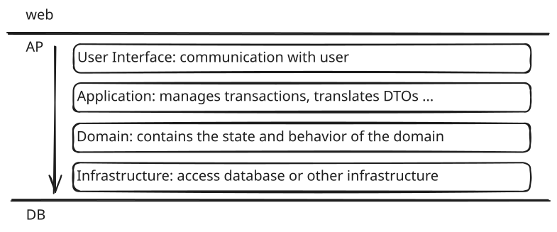

## ドメイン駆動設計

### 特徴

業務ファーストの姿勢を示していることが特徴

- 業務仕様やビジネスルールの複雑さを紐解き、顧客の課題を正しく理解する
- 業務の専門家とソフトウェアの専門家が協力し、ドメインモデルを作る
- ドメインモデルを明示的に表現するコードを書き、ソフトウェアを作る
- エンジニアである方もそうでない方（業務担当者など）も理解できる共通言語を使って会話する

### メリット

- 業務要件を第一にしたシステムを設計・構築できる
- 複雑な機能要件も正しく理解し、コーディングできる
- リファクタリングも行ないやすく、保守性が向上する

### 開発の流れ

1. 業務内容の調査

- 業務分析を行なう
- ドメインエキスパート（業務担当者や、業務に関する豊富な知識を持つ方）との対話

2. 仕様のモデルか

- 図はもちろん、文章などでも表現できます。
- 両者の認識に相違があると、手戻りが大きくなります。納得いくまで議論を重ね、良いドメインモデルを作り上げましょう。

3. 業務ロジックの抽出

- ドメインモデルに含まれるビジネスルールを洗い出し、ロジックに落とし込みましょう。可能であればコードで示すことも、良い方法の一つに挙げられます。

4. コードか

- 示されたロジックに対して忠実にコーディングし、ドメインモデルを表現します。「コーディングしにくい」などの理由で、勝手にロジックを変えてはいけません。
- ドメイン駆動設計では、オブジェクトが用いられています。このため開発言語は、オブジェクト指向に対応した言語が選ばれることでしょう。

5. ブラッシュアップ

- 課題を解決するフェーズを繰り返し、品質を上げることになるでしょう
- またドメイン駆動設計は、アジャイル開発を選ぶケースが多くなるでしょう。

### SUDO モデリング

- システム図
- ユースケース図
- ドメインモデル図
- オブジェクト図
- 必要に応じて、状態遷移図、ER 図
