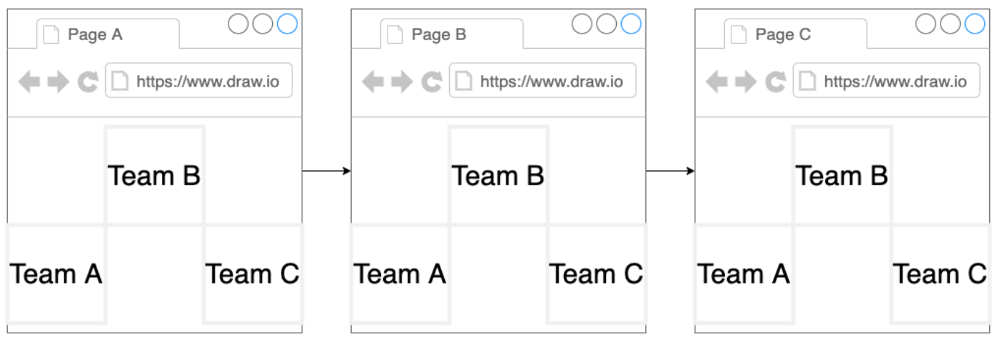
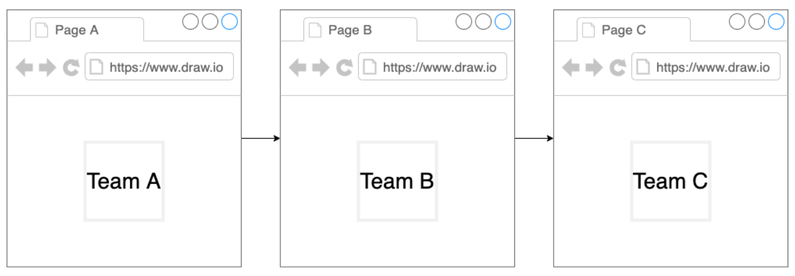

## MicroFrontend

メリットとデメリット

- メリット
  - 独立性: 任意のテクノロジーと任意のチームで開発可能
  - 展開: 特定の機能をエンドツーエンド（バック、フロント、デプロイ）で確実に実行可能
  - 俊敏性: フロントエンドのアップグレード/変更にはコストが小さい
  - 専門性: 特定のドメインについての機能だけに集中できる
- デメリット
  - 独立性: 全チームへ共有すべき関心事を周知する仕組みが必要
    - デザインシステム、パフォーマンス、ナレッジ
  - 俊敏性: 一部の標準コンポーネントを共有できず、個別のフロントエンドで実装が重複してしまう
  - パフォーマンス: すべてのチームが採用しているライブラリのセキュリティパッチは、それぞれのチームが更新しなければならない

build-time integration

- Compile-Time Integration

run-time integration

- ClientSide Integration

Server Integration

水平分割: 画面ないにある要素で分割

垂直分割: 画面ごとに分割

#1 Inflexible Requirement

Zero coupling between child projects

- No importing of functions/objects/classes/etc
- No shared state
- Shared libraries through MF is ok

#2 Inflexible Requirement

Near-zero coupling between container and child apps

- Container shouldn't assume that a child is using a particular framework
- Any necessary communication done with callbacks or simple events

#3 Inflexible Requirement

Css from one project shouldn't affect another

#4 Inflexible Requirement

Version control (monorepo vs separate) shouldn't have any impact on the overall project

- Some people want to use monorepos
- Some people want to keep everything in a separate repo

#5 Inflexible Requirement

Container should be able to decide to always use the latest version of a microfrontend or specify a specific version

- Container will always use the latest version of a child apps(doesn't require a redeploy of container)
- Container can specify exactly what version of a child it wants to use(requires a redeploy to change)
