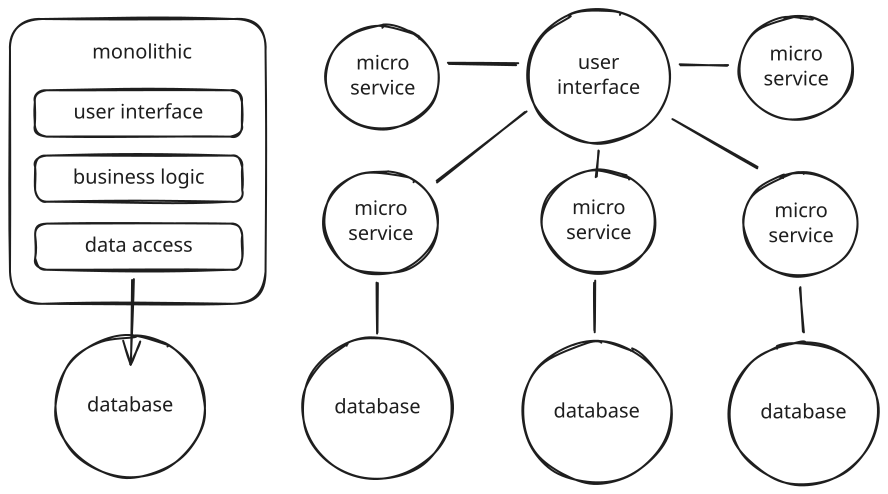
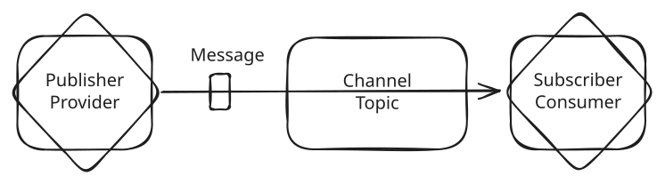
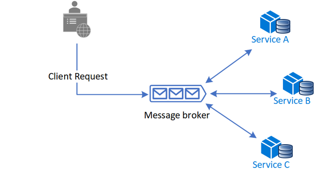
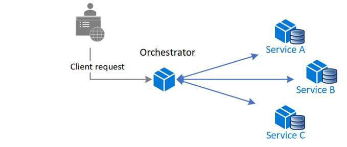

## Monolithic vs Microservices

### Architecture

### 利点および課題

**モノリシック（モノリス）**: 必要なコンポーネントがすべて一つのアプリケーションの中に含まれるような構成

| 分類               | 利点             | 肥大化の課題                         |
| ------------------ | ---------------- | ------------------------------------ |
| 開発               | 開発しやすい     | 修正／機能追加の影響範囲特定が難しい |
|                    | テストしやすい   |                                      |
| デプロイ／リリース | デプロイしやすい | 調整が大変                           |
| 運用               | 障害調査しやすい | 技術スタックが陳腐化しやすい         |
|                    |                  | 信頼性が低い（障害時）               |

**マイクロサービス**: アプリケーションの構成を独立したサービス群へ分割

> サービス：何かしらの機能を実現する単独動作、単独デプロイ/リリースできるコンポーネント

- API
- ロジック
- データ

| 分類               | 利点                               | 課題                                 |
| ------------------ | ---------------------------------- | ------------------------------------ |
| 修正               | 修正範囲がサービスに限定される     | サービス分割が難しい                 |
|                    |                                    | アプリケーション設計が煩雑になる     |
| デプロイ／リリース | CICD で必要なテストが容易になる    | アプリケーション全体のテストが難しい |
|                    | 素早くリリースできる               |                                      |
| 運用               | サービスに合わせたスケールができる |                                      |
|                    | 障害分離しやすい                   |                                      |
|                    | 新しい技術取り入れやすい           |                                      |

### 開発体制の違い

|              | モノリス                                                   | マイクロサービス                       |
| ------------ | ---------------------------------------------------------- | -------------------------------------- |
| 開発体制     | フロントエンドチーム、バックエンドチーム、アプリ基盤チーム | 機能 A チーム、機能 B チーム           |
| 法則         | コンウェイの法則                                           | 逆コンウェイの法則                     |
| 開発サイクル | 開発＞リリース＞運用保守                                   | 開発と運用保守が同時進行、随時リリース |

### マイクロサービスと SOA

- SOA(Service Oriented Architecture): システムの機能単位を業務単位で決めていく設計

  | 観点               | SOA                         | マイクロサービス     |
  | ------------------ | --------------------------- | -------------------- |
  | アーキテクチャ     | リソース共有                | 独立したサービス     |
  | コンポーネント共有 | 共有する                    | 共有しない           |
  | サービス粒度       | 大きい                      | 非常に小さい         |
  | データ             | 共有 DB                     | 独立 DB              |
  | サービス間通信     | ESB(Enterprise Service Bus) | メッセージブロッカー |
  | 通信プロトコル     | SOAP                        | REST,gRPC            |

## マイクロサービスの課題

### サービス分割方法

一つのサービスに API、ロジック、データ(Database)が含める
サービス更新時の更新範囲は特定のサービスに限定できるように分割する

### サービス間の通信方式

|            | 1 対 1    | 1 対多         |
| ---------- | --------- | -------------- |
| 同期通信   | REST,gRPC |                |
| 非同期通信 | Batch     | Message Broker |

### メッセージブロッカー

- 非同期にメッセージ交換
- 専用ミドルウェアを介してメッセージを交換

利点:

- 疎結合できる
- メッセージのバッファリングができる

欠点:

- パフォーマンスのボトルネックになる
- 単一障害点になる
- 運用複雑になる

方式:

- Pull(Queuing): Consumer が定期的にメッセージ取りに行くため、処理料多くでも対応できるが、タイムラグ出る。
- Push(Pub/Sub): Producer がメッセージを Consumer に送信する。Consumer のリソース状況を考慮する必要がある。リアルタイムに近づけられる。

OpenSource:

- Apache Kafka: Pull
- Apache ActiveMQ: Pub/Sub
- RabitMQ: AMQP(Advanced Message Queuing Protocol)
- Redis: KVS

### Database 共有

**マイクロサービス基本 NG**  
Database の View やテーブルそのものを公開してデータ連携する

利点:

- 大量データを移す必要がない
- 反映した即時のデータを扱える

欠点:

- データ所有権が元データにあるため、データ修正の場合影響範囲広がる

### サーキットブレーカーの選定

タイムアウト発生する時、通信を遮断して、即時エラーを返すような仕組み

OpenSource:

- istio
- resilience4j

### Service Discovery

OpenSource:

- etcd/coredns
- consul
- Zookeeper

### SAGA Pattern

SAGA 設計パターンは、分散トランザクションシナリオでマイクロサービス間のデータの一貫性を管理する方法  
SAGA によって各サービスが更新され、次のトランザクションステップをトリガーする  
ステップが失敗すると、その前のトランザクションを無効にする補正トランザクションを実行される。

- コレオグラフィ: 各サービスが必要なイベントをサブスクして協調する
  
- オーケストレーション: 中央のコーディネーターが各サービスに対して指示する。複雑なトランザクション対応可能
  

#### SAGA の問題

**ローカルトランザクション**: オーケストレータからのメッセージを契機に各マイクロサービスにより実行され、ローカルな ACID トランザクションとしてその都度コミットまたはロールバックされるサーガ内のステップ

**ローカルトランザクションの種類**

- **Compensatable Transaction**: 補償 (compensate)可能な、つまり状況に応じて後で変更を打ち消すことができるローカルトランザクション
- **Pivot Transaction**: サーガの構成として、前半に Compensatable なトランザクションの一群を置き、後半に Retriable（次に記述）な一群を置く。ここで Compensatble と Retriable の境界に位置するローカルトランザクションを Pivot Transaction と呼ぶ
- **Retriable Transaction**: Pivot 以降にまとめて置かれるトランザクションで、ロールバック不要で成功が保証されているもの
- **Compensating Transaction**: Compensatable Transaction に付随するもので、サーガが中止される場合には、対応する実行済み Compensatable Transaction と逆順で実行される

トランザクションには、原子性、一貫性、分離性、持続性 (ACID)が必要です  
ACID の Isolation(独立性):トランザクションの途中状態が外部に見れてしまう

- ロストアップデート: 他の更新処理を古い情報をもとに上書きしてしまい、更新したはずのデータが消える
- ダーティーリード: 更新途中の状態を読み取ってしまい、不整合が起こる
- ファジーリード: 他の更新処理を古い情報をもとに上書きしてしまい、更新したはずのデータが消える
- ファントムリード: SAGA の読み取り操作において、他の SAGA が途中で動作すると、タイミングによって異なる結果になる

解決方法:

- Semantick Lock: 従来の DBMS によるロックではなく、アプリケーションレベルで実装するロック
- Re-Read Value
- Commutative Updates
- Pessimistic View / Optimistic View
- Version File
- By Value

### データの結合

#### API Composition

ある一つのサービスが中心となってデータを収集して結合行う

欠点:

- オーバーヘッド（負荷）が増加する
  - 複数のサービスを呼び出し、各サービスでクエリを実行します。よって必要となる計算やネットワークリソースが増加します。
- 可用性が低下する
  - 複数のサービスを呼び出して、仮に一つのサービスが落ちてしまっていたら期待する結果が得られません。

#### CQRS

CQRS(Command Query Responsibility Segregation)コマンドクエリ責務分離

- Command(Create, Update, Delete)と Query(Get)を分離する

### 認証認可

API Gateway で認証、各サービスで認可実施

### テスト

- 単体テスト: サービス内のクラスに対するテスト
  - マイクロサービスにした結果、モック、スタブが大量に必要
    - OpenAPI/Mockito/Nock
- 結合テスト: 依存関係のあるサービスのみを結合したテスト
- 受け入れテスト: 関連サービスをすべて結合したテスト
- E2E テスト: すべてのサービスを連携させ End to End でテスト

### デプロイ

- Blue/Green デプロイ
- ローリングデプロイ: カナリアリリース/一括リリース

### 運用監視

#### Health Check

専用の API を作る(Get /health, SELECT 1 FROM DB)

#### Observability(可観測性)

1. ログ: 各サービスで発生するイベントの記録

   - ログを一箇所に集約/永続化する
   - ログ送信エージェント＞(バファリング)＞ログ収集＞可視化
     - Tools:
       - ElasticSearch LogStash Kibana
       - Fluentd
       - Prometheus Grafana

2. メトリクス: 各サービスの定量数値情報(cpu, mem, disk, nw)

   - Tools:
     - ElasticSearch LogStash Kibana
     - Fluentd
     - Prometheus Grafana

3. トレーシング: リクエストに対して各サービスの処理記録
   - Trace: リクエスト全体
   - Span: 各サービスの処理時間
   - TraceID,SpanID,Parent SpanID を付与することで識別
   - Tools:
     - OpenTelemetry
     - OpenTracing
     - Zipkin
     - Jaeger
