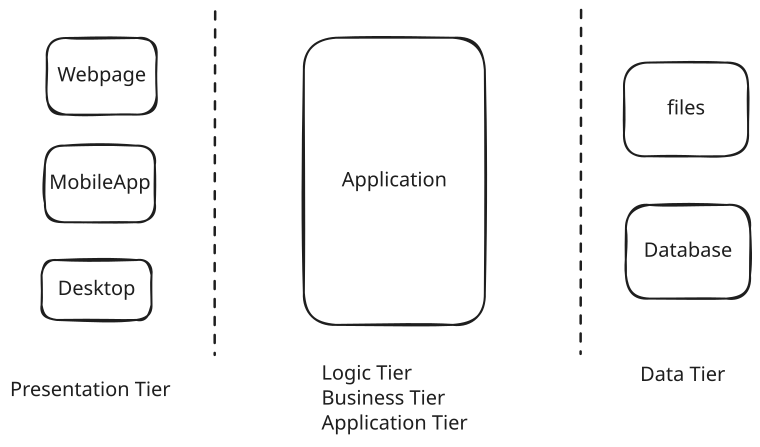
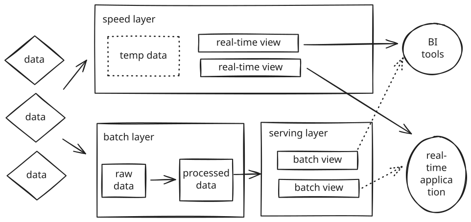

## Multi-Tier Architecture

Pros:

- easy to maintain and develop

Cons:

- monolithic structure
- no business logic in the presentation tier and data tier
- high cpu and memory consumption
- low development velocity

## Microservices Architecture

## Event Driven Architecture

## Lambda Architecture

