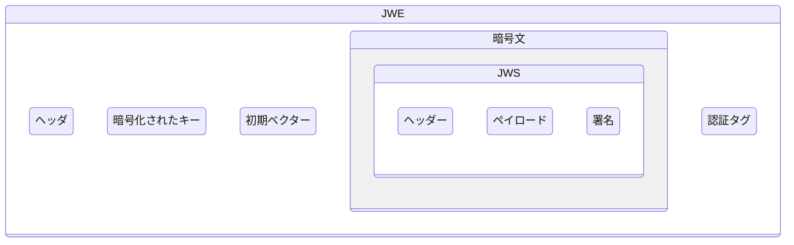
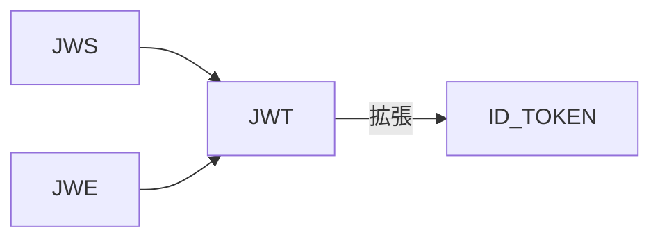
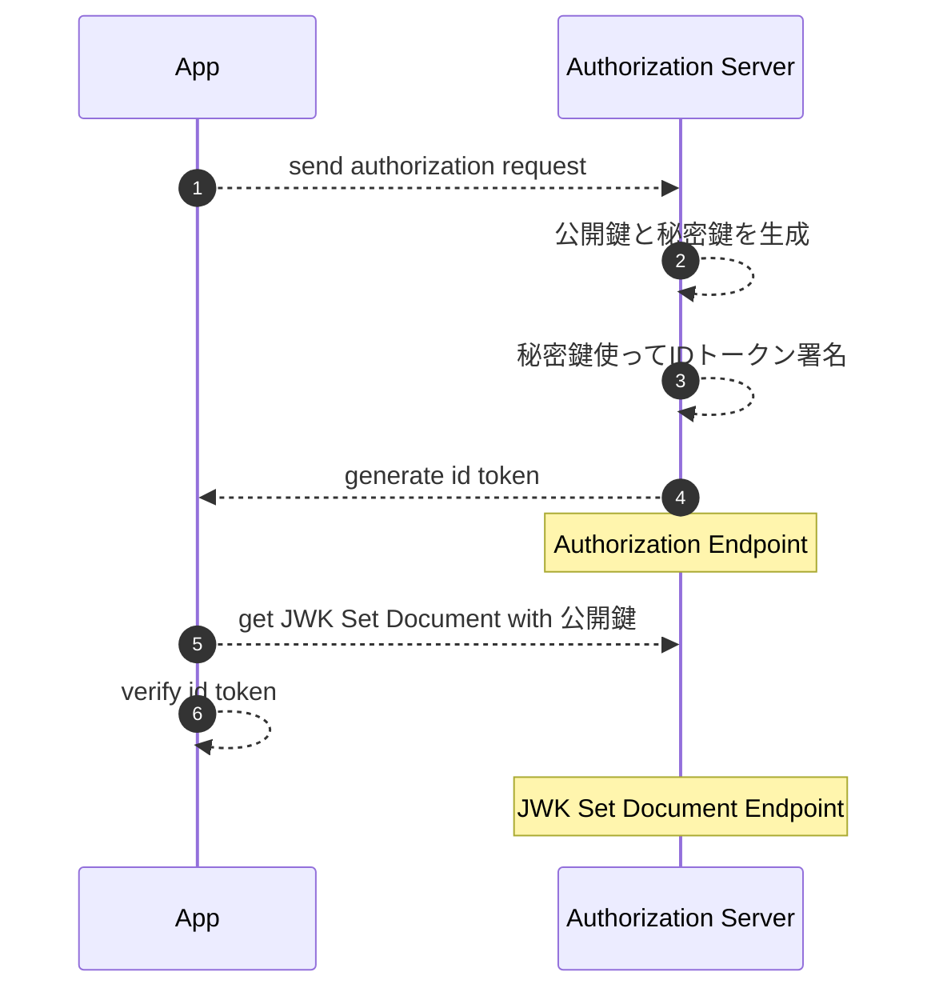
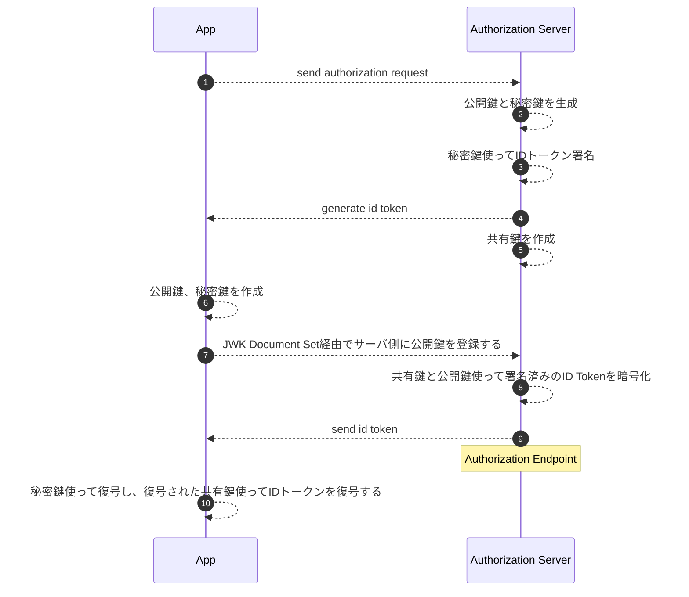

## JWS (JSON Web Signature)

[RFC7515](https://datatracker.ietf.org/doc/html/rfc7515)

| ヘッダー | ペイロード | 署名 |
| -------- | ---------- | ---- |

```
BASE64URL(UTF8(JWS Protected Header)) || '.' ||
BASE64URL(JWS Payload) || '.' ||
BASE64URL(JWS Signature)
```

**ヘッダー**

```json
example:

{
  "typ":"JWT",
  "alg":"HS256"
}
```

| Header Parameter | Description                          |
| ---------------- | ------------------------------------ |
| alg              | Algorithm                            |
| jku              | JWK Set URL                          |
| jwk              | JSON Web Key                         |
| kid              | Key ID                               |
| x5u              | XMLDocument.509 URL                  |
| x5c              | X.509 Certificate Chain              |
| x5t              | X.509 Certificate SHA-1 Thumbprint   |
| x5t#S256         | X.509 Certificate SHA-256 Thumbprint |
| typ              | Type                                 |
| cty              | Content Type                         |
| crit             | Critical                             |

**ペイロード**
|任意のバイト列|
|-|

```json
RFC7515では定義されていない、通常はJWT仕様に従ってJSONとして定義する

example:
{
  "iss":"joe",
  "exp":1300819380,
  "http://example.com/is_root":true
}
```

**署名**
|バイナリデータ|
|-|

HMAC SHA-256 アルゴリズムで、ヘッダーとペイロードの HMAC を計算し、その結果を base64url エンコードする

## JWE (JSON Web Encryption)

[RFC7516](https://datatracker.ietf.org/doc/html/rfc7516)

| ヘッダー | 暗号化されたキー | 初期ベクター | 暗号文 | 認証タグ |
| -------- | ---------------- | ------------ | ------ | -------- |

```
BASE64URL(UTF8(JWE Protected Header)) || '.' ||
BASE64URL(JWE Encrypted Key) || '.' ||                  //Encrypted Key: 「共有鍵を非対称鍵で暗号化する」という二段階の暗号処理をしているため
BASE64URL(JWE Initialization Vector) || '.' ||
BASE64URL(JWE Ciphertext) || '.' ||
BASE64URL(JWE Authentication Tag)
```

**ヘッダー**

```json
alg: 共有鍵の暗号アルゴリズム
enc: 平文の暗号アルゴリズム

{"alg":"RSA-OAEP","enc":"A256GCM"}
```

| Header Parameter | Description                          |
| ---------------- | ------------------------------------ |
| alg              | Algorithm                            |
| enc              | Encryption Algorithm                 |
| zip              | Compression Algorithm                |
| jku              | JWK Set URL                          |
| jwk              | JSON Web Key                         |
| kid              | Key ID                               |
| x5u              | XMLDocument.509 URL                  |
| x5c              | X.509 Certificate Chain              |
| x5t              | X.509 Certificate SHA-1 Thumbprint   |
| x5t#S256         | X.509 Certificate SHA-256 Thumbprint |
| typ              | Type                                 |
| cty              | Content Type                         |
| crit             | Critical                             |

## JWT (JSON Web Token)

[RFC7519](https://datatracker.ietf.org/doc/html/rfc7519)

JSON 形式で表現されたクレーム(Claim, JSON のキーバリュー値)の集合を JWS または JWE に埋め込んだものを JWT と呼ぶ

| 登録済みクレーム | 意味            | 説明             |
| ---------------- | --------------- | ---------------- |
| iss              | Issuer          | 発行者           |
| sub              | Subject         | 主体識別子       |
| aud              | Audience        | 利用者           |
| exp              | Expiration Time | 有効期限終了時刻 |
| nbf              | Not Before      | 有効期限開始時刻 |
| iat              | Issued At       | 発行時刻         |
| jti              | JWT ID          | JWT ID           |

JWS > 署名  
JWT > 暗号化  
署名と暗号化両方したい時、JWS を JWE で包むか、JWE を JWS で包むことを Nested JWT と呼ぶ



## JWK (JSON Web Key)

[RFC7517](https://datatracker.ietf.org/doc/html/rfc7517)

暗号鍵を表現するための JSON データ構造

```json
JWK Set Document

{
  "keys"; [
    {
      "kty": "",        //rsa, ec, ...
      "use": "",        //sig, enc
      "key_ops": "",    //sign, verify, encrypt, decrypt, wrapKey, unwrapKey, deriveKey, deriveBits
      "alg": "",
      "kid": "",
      "x5u": "",
      "x5c": "",
      "x5t": "",
      "x5t#S256": "",
    },
    {
      "kty":"EC",
      "crv":"P-256",
      "x":"f83OJ3D2xF1Bg8vub9tLe1gHMzV76e8Tus9uPHvRVEU",
      "y":"x_FEzRu9m36HLN_tue659LNpXW6pCyStikYjKIWI5a0",
      "kid":"Public key used in JWS spec Appendix A.3 example"
     }
  ]
}
```

## JWA (JSON Web Algorithms)

[RFC7518](https://datatracker.ietf.org/doc/html/rfc7518)

JWS, JWE, JWK に必要なアルゴリズムを定義する

- ["alg" Header Parameter for JWS](https://datatracker.ietf.org/doc/html/rfc7518#section-3)
- ["alg" Header Parameter for JWE](https://datatracker.ietf.org/doc/html/rfc7518#section-4.1)
- ["enc" Header Parameter for JWE](https://datatracker.ietf.org/doc/html/rfc7518#section-5)
- ["kty" Header Parameter for JWK](https://datatracker.ietf.org/doc/html/rfc7518#section-6)

## ID Token



| タイプ | 説明                                         |
| ------ | -------------------------------------------- |
| 署名   | 必須                                         |
| 暗号化 | 任意、ただし、暗号化の際は署名後に暗号化する |

### クレーム

#### ユーザ認証クレーム

| クレーム  | 意味                                   | 説明                                       |
| --------- | -------------------------------------- | ------------------------------------------ |
| iss       | Issuer Identifier                      | ID トークン発行者                          |
| sub       | Subject Identifier                     | 認証されたユーザの一意識別子               |
| aud       | Audience                               | 想定する ID トークン利用者                 |
| exp       | Expiration time                        | 有効期限終了時刻                           |
| iat       |                                        | ID トークン発行時刻                        |
| auth_time |                                        | ユーザが認証された時刻                     |
| nonce     |                                        | リプレイアタックを防ぐためのランダム文字列 |
| acr       | Authentication Context Class Reference | ユーザ認証が満たした認証コンテキストクラス |
| amr       | Authentication Methods References      | ユーザ認証方法                             |
| azp       | Authorized party                       | 承認された ID トークン発行対象             |

#### ユーザ属性クレーム

| クレーム              | Type        | 説明               |
| --------------------- | ----------- | ------------------ |
| sub                   | string      | ユーザの一意識別子 |
| name                  | string      |                    |
| given_name            | string      |                    |
| family_name           | string      |                    |
| middle_name           | string      |                    |
| nickname              | string      |                    |
| preferred_username    | string      |                    |
| profile               | string      |                    |
| picture               | string      |                    |
| website               | string      |                    |
| email                 | string      |                    |
| email_verified        | boolean     |                    |
| gender                | string      |                    |
| birthdate             | string      |                    |
| zoneinfo              | string      |                    |
| locale                | string      |                    |
| phone_number          | string      |                    |
| phone_number_verified | boolean     |                    |
| address               | JSON Object |                    |
| updated_at            | number      |                    |

#### 特殊クレーム

| クレーム | 説明                                                            |
| -------- | --------------------------------------------------------------- |
| at_hash  | ID トークンと同時に発行されるアクセストークンのハッシュ値       |
| c_hash   | ID トークンと同時に発行される認可コードのハッシュ値             |
| s_hash   | 認可リクエストに含まれていた state パラメーターの値のハッシュ値 |

```
example:
{
  "iss": "https://server.example.com",
  "sub": "24400320",
  "aud": "s6BhdRkqt3",
  "nonce": "n-0S6_WzA2Mj",
  "exp": 1311281970,
  "iat": 1311280970,
  "auth_time": 1311280969,
  "acr": "urn:mace:incommon:iap:silver"
}
```

### ID Token の署名



### ID Token の暗号化



サーバはクライアントの JWK Set Document の場所を知る方法:

- クライアントアプリの属性 jwks の値(JWK Set Document そのもの)をサーバに登録する
- クライアントアプリの属性 jwks_uri の値(JWK Set Document の置かれた場所)をサーバに登録する

署名アルゴリズム: id_token_signed_response_alg  
共有鍵暗号化アルゴリズム: id_token_encrypted_response_alg  
本文暗号化アルゴリズム: id_token_encrypted_response_enc
