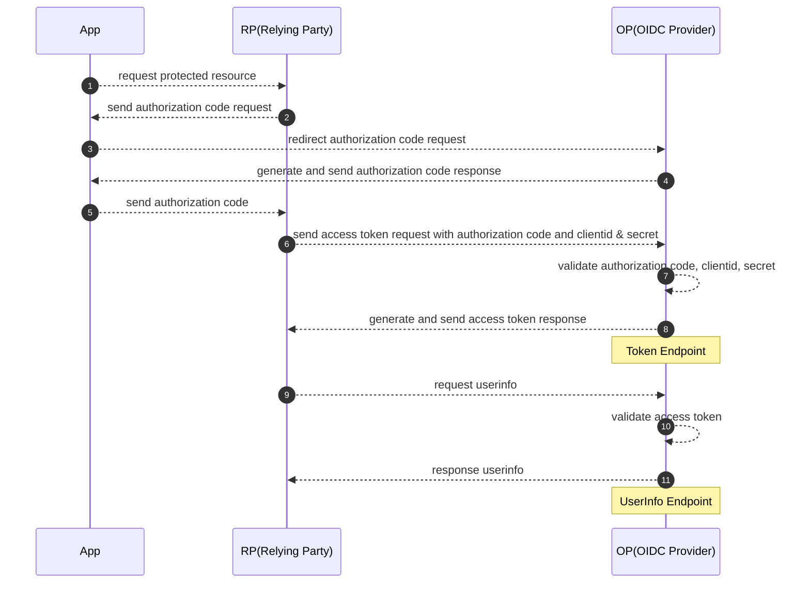
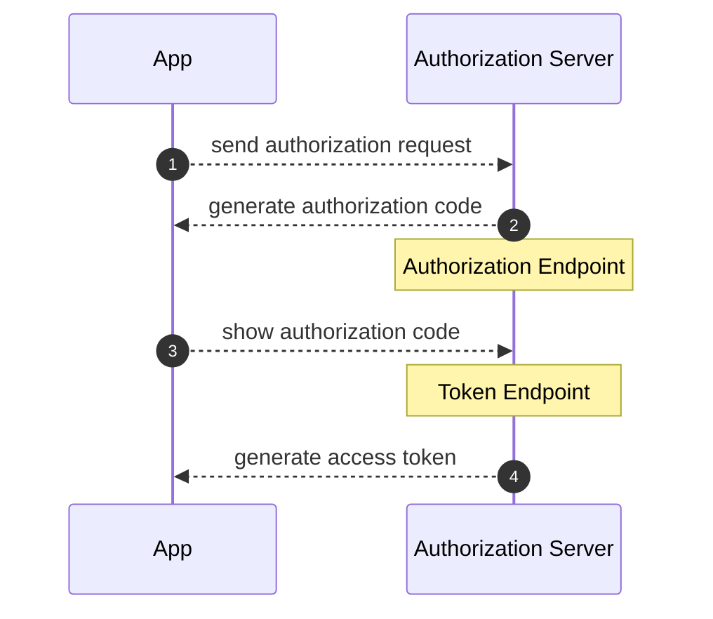
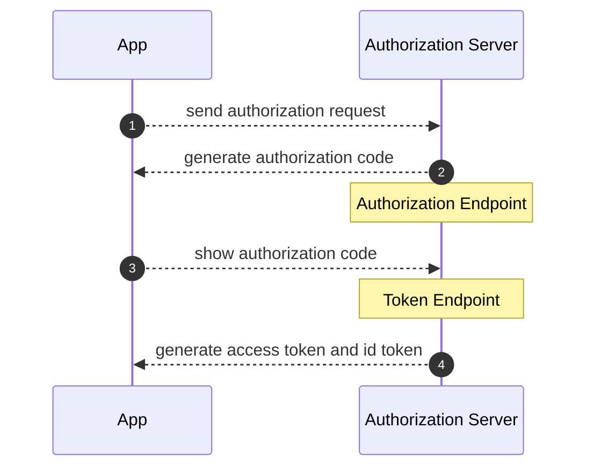
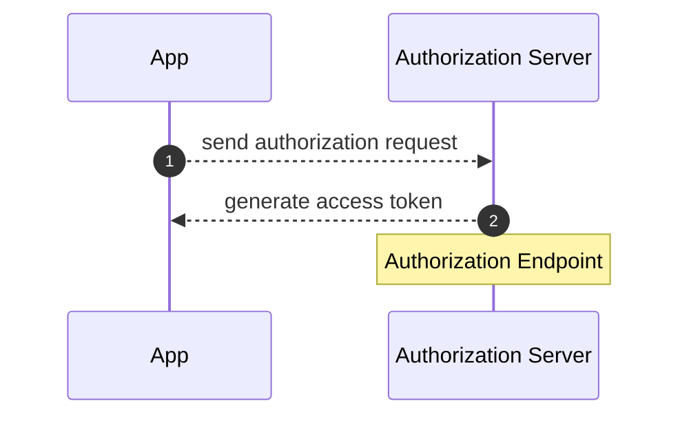
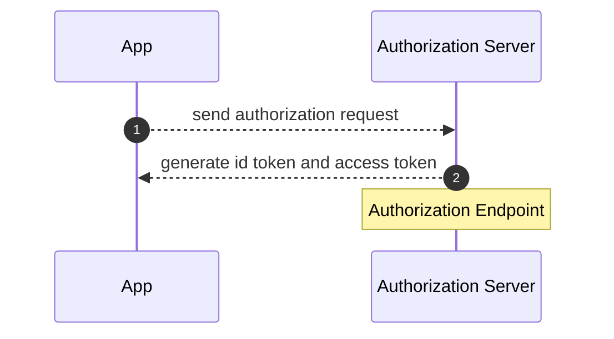
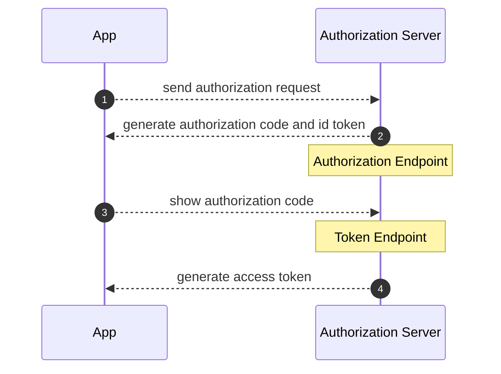
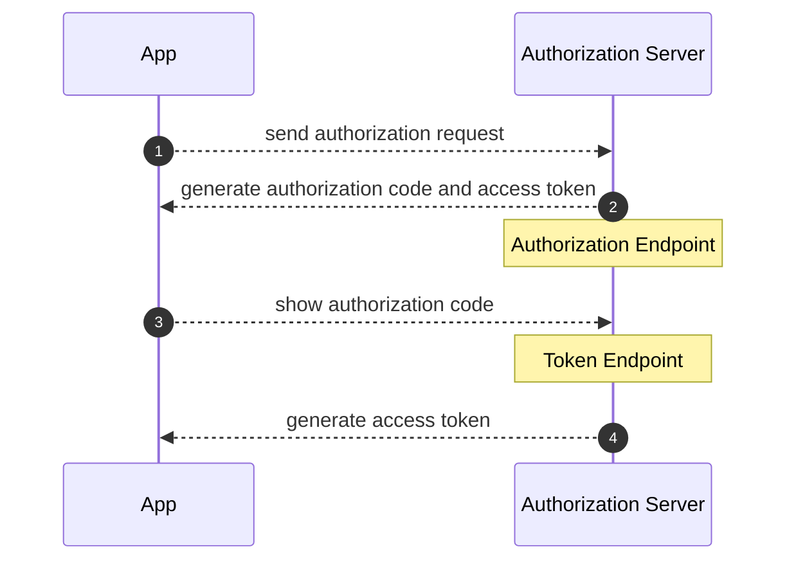
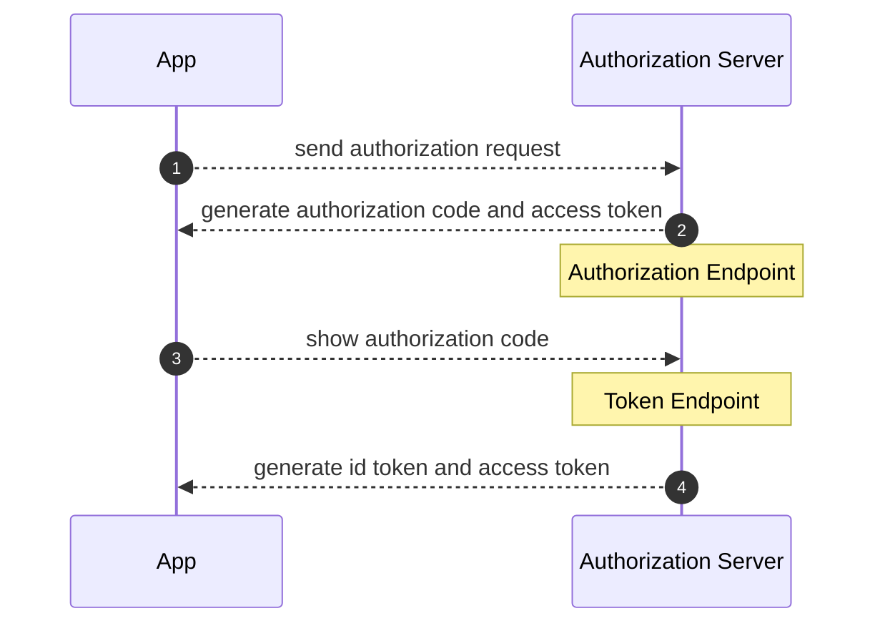
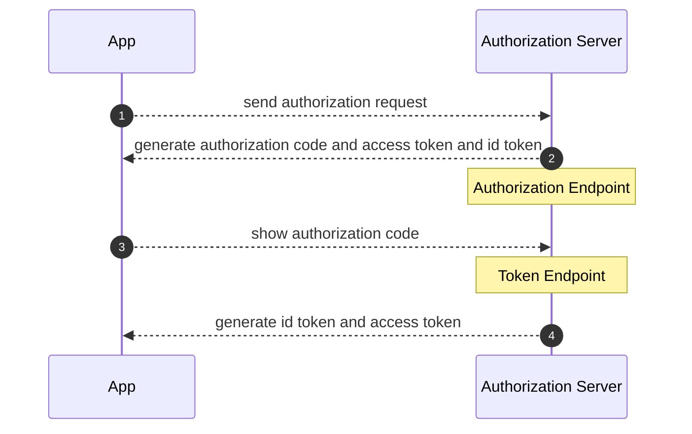
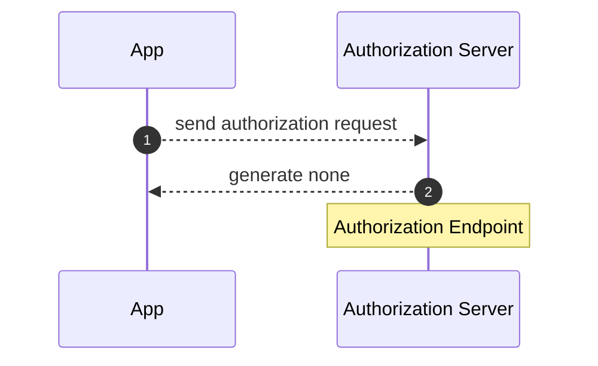

[OpenID Connect Core 1.0](https://openid.net/specs/openid-connect-core-1_0.html)

OP(OIDC Provider)  
RP(Relying Party)

OAuth2.0 より response_type の仕様を拡張した

- id_token 追加
- none 追加
- code, token, id_token の任意の組み合わせを許可
- scope パラメータに openid 含められるように

### response_type=code (scope に openid を含まない)

OAuth2.0 認可コードフローと同じ

### response_type=code (scope に openid を含む)

ID Token と Access Token が一緒に発行される

### response_type=token (scope に openid を含まない)

OAuth2.0 インプリシットフローと同じ

### response_type=id_token (scope に openid を含む)

ID Token のみ発行される

### response_type=id_token token (scope に openid を含む)

ID Token と Acess Token が一緒に発行される

### response_type=code id_token (scope に openid を含む)

一時的に authorization_code が発行される  
ID Token と Access Token が発行される
ID Token が 2 回発行されるが、同じでもいい、異なってもいい

### response_type=code token (scope に openid を含まない)

一時的に authorization_code が発行される  
Access Token が 2 回発行されるが、同じでもいい、異なってもいい

### response_type=code token (scope に openid を含む)

一時的に authorization_code が発行される  
ID Token と Access Token が発行される
ID Token が 2 回発行されるが、同じでもいい、異なってもいい

### response_type=code id_token token (scope に openid を含む)

一時的に authorization_code が発行される  
ID Token と Access Token が 2 回発行されるが、同じでもいい、異なってもいい

response_type=none (scope に openid を含まない)

何も生成されない、ログインのみチェックするなどに利用

