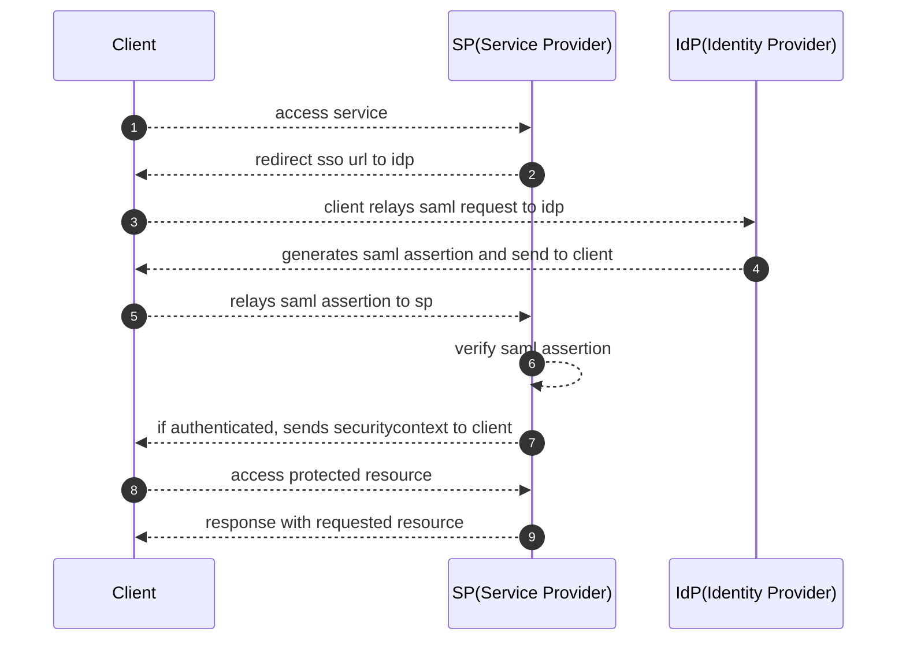

[OASIS-OPEN](https://docs.oasis-open.org/security/saml/Post2.0/sstc-saml-tech-overview-2.0.html),
[RFC7522](https://datatracker.ietf.org/doc/html/rfc7522)

SP(Service Provider): サービス提供エンティティー、通常はアプリケーション  
IdP(Identity Provider): 認証サービスを提供するエンティティー  
SP-Initiated(Service Provider Initiated): サービスプロバイダーから開始する SAML サインインフロー  
IdP-Initiated(Identity Provider Initiated): IdP から開始する SAML サインインフロー
RelayState: HTTP パラメータ、SAML リクエストとレスポンスに含まれる