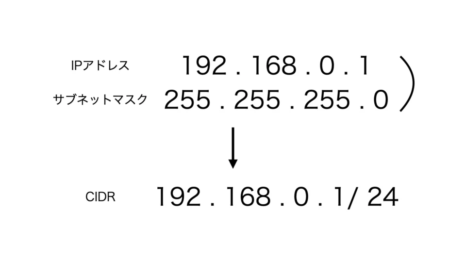

##### IP アドレスのクラス

| Class    | IP Range                    |
| -------- | --------------------------- |
| クラス A | 0.0.0.0 - 127.255.255.255   |
| クラス B | 128.0.0.0 - 191.255.255.255 |
| クラス C | 192.0.0.0 - 223.255.255.255 |
| クラス D | 224.0.0.0 - 239.255.255.255 |
| クラス E | 240.0.0.0 - 255.255.255.255 |

##### プライベート IP アドレスのクラス範囲

| Class    | IP Range                                         |
| -------- | ------------------------------------------------ |
| クラス A | 10.0.0.0 ～ 10.255.255.255（10.0.0.0/8）         |
| クラス B | 172.16.0.0 ～ 172.31.255.255（172.16.0.0/12）    |
| クラス C | 192.168.0.0 ～ 192.168.255.255（192.168.0.0/16） |

##### グローバル IP アドレスのクラス範囲

| Class    | IP Range                                                     |
| -------- | ------------------------------------------------------------ |
| クラス A | 1.0.0.0 ～ 9.255.255.255、11.0.0.0 ～ 126.255.255.255        |
| クラス B | 128.0.0.0 ～ 172.15.255.255、172.32.0.0 ～ 191.255.255.255   |
| クラス C | 192.0.0.0 ～ 192.167.255.255、192.169.0.0 ～ 223.255.255.255 |

##### CIDR(Classless Inter-Domain Routing)



```
CIDRは、クラスに縛られずIPアドレスのネットワーク部・ホスト部の桁数を自由に決めることができるようにした仕組みです。
これまでIPアドレスとサブネットマスクの二つに分けて表記されていた情報を、CIDRでは一つに合わせて表記します。
「/」の後に、ネットワーク部・ホスト部の区切りの桁数がきます。
IPアドレスは十進数で表記されていますが、この区切りの桁数は、IPアドレスを二進数表記にした際の区切りの桁数です。
```

##### VPC 作成

1. VPC 作成
2. Subnet 作成（Public x2, Private x2）
3. Public Subnet Route table(rtb-pub)作成、明示的関連付け
4. Internet Gateway(igw)作成、VPC 関連付け
5. rtb-pub に igw ルート追加(0.0.0.0/0 > igw)
6. Private Subnet Route table(rtb-pri-01, rtb-pri-02)作成、明示的関連付け

##### VPC Endpoint

1. Gateway Endpoint: 無料

```
S3, DynamoDBのみサポート
VPCの外から接続できない（例：オンプレ＞EC2）
ルートテーブルにルート追加必要
パブリックIPの接続となる
```

2. Interface Endpoint: データ量と利用時間

```
ほとんどのサービスをサポート
VPCの外から接続できる（例：オンプレ＞EC2）
プライベートIPの接続となる（裏でENIが作成される）
AWS PrivateLinkを利用
```
