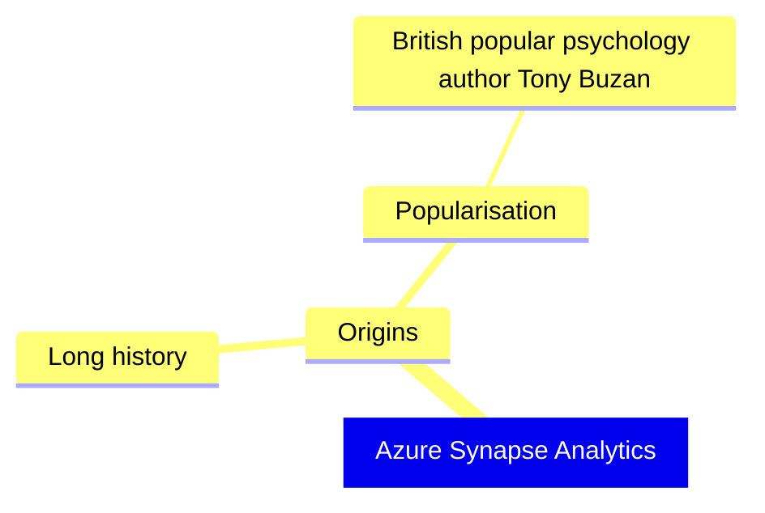
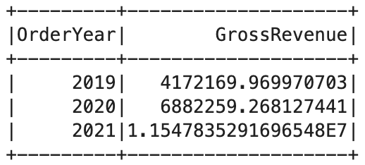
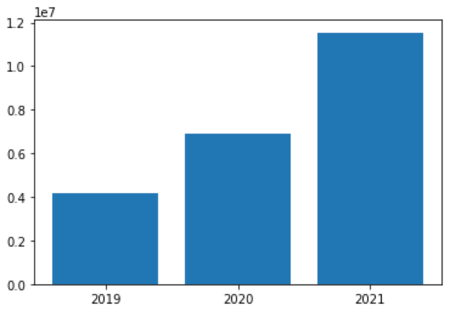
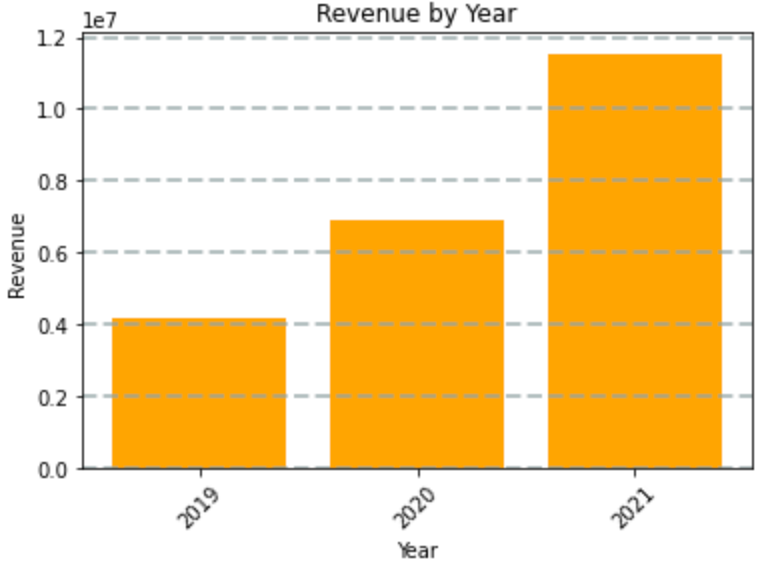
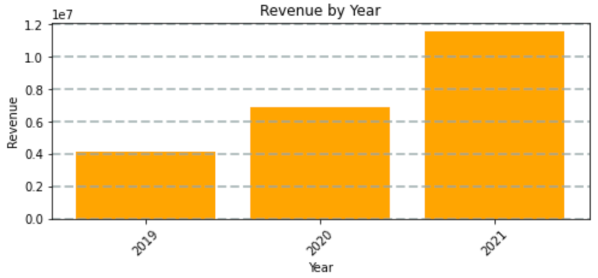
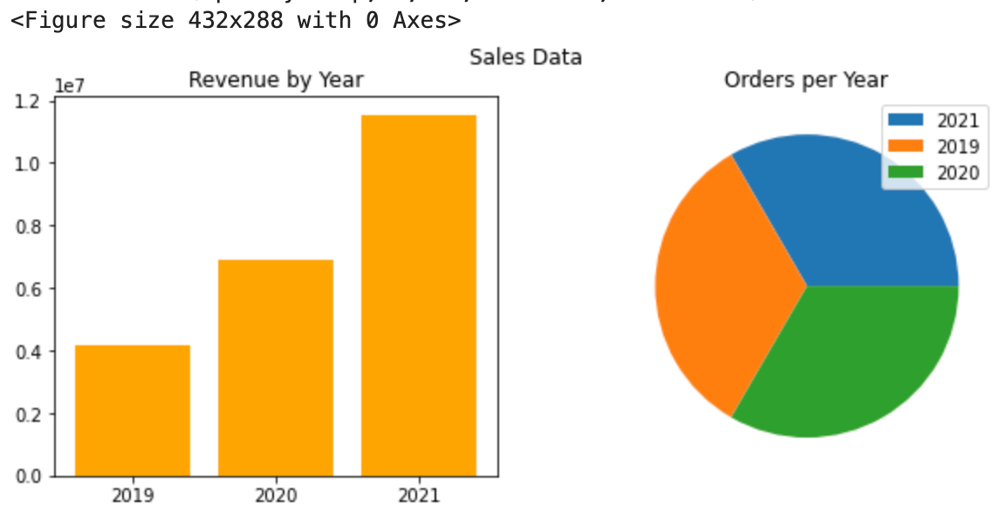
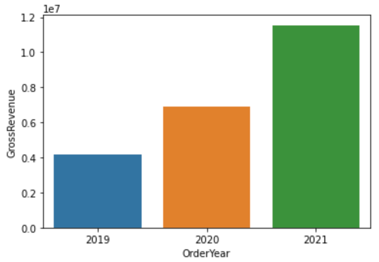
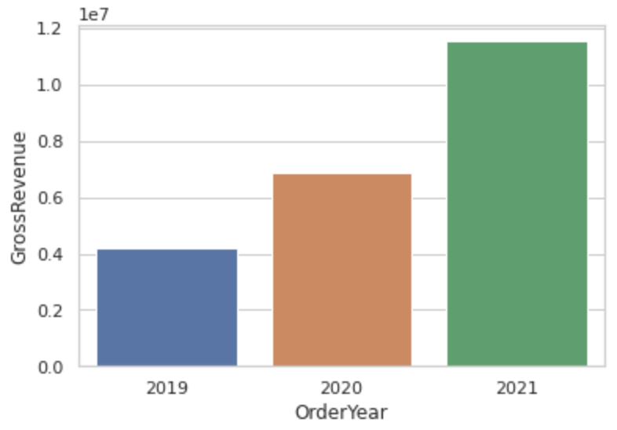
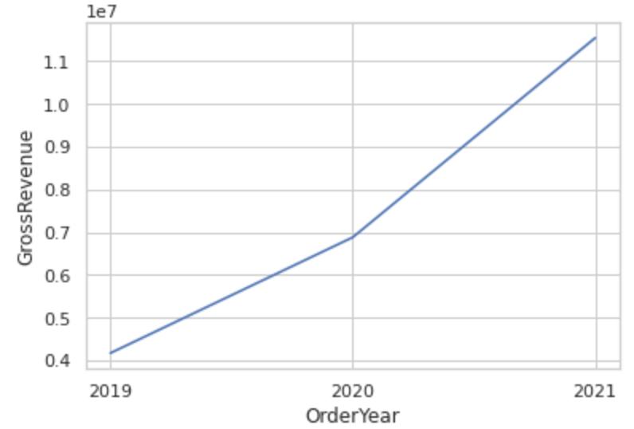

## Azure Synapse Analytics

### SQL スクリプト実行方法

**サーバレスの SQL Pool を利用する**

```sql
SELECT
  TOP 100 *
FROM
  OPENROWSET(
    BULK 'https://datalakexxxxxxx.dfs.core.windows.net/files/product_data/products.csv',
    FORMAT = 'CSV',
    PARSER_VERSION='2.0'
  ) AS [result]
```

**Spark Pool を利用する**

```python
%%pyspark
df = spark.read.load('abfss://files@datalakexxxxxxx.dfs.core.windows.net/product_data/products.csv', format='csv', header=True
)
display(df.limit(10))
```

```python
df_counts = df.groupby(df.Category).count()
display(df_counts)
```

**専用 SQL Pool を利用する**

```sql
SELECT d.CalendarYear, d.MonthNumberOfYear, d.EnglishMonthName,
       p.EnglishProductName AS Product, SUM(o.OrderQuantity) AS UnitsSold
FROM dbo.FactInternetSales AS o
JOIN dbo.DimDate AS d ON o.OrderDateKey = d.DateKey
JOIN dbo.DimProduct AS p ON o.ProductKey = p.ProductKey
GROUP BY d.CalendarYear, d.MonthNumberOfYear, d.EnglishMonthName, p.EnglishProductName
ORDER BY d.MonthNumberOfYear
```

### CREATE EXTERAL TABLE AS SELECT (CETAS) ステートメントを使用してデータを変換する

**外部データソースとファイル形式を作成する**

```sql
-- Database for sales data
CREATE DATABASE Sales
  COLLATE Latin1_General_100_BIN2_UTF8;
GO;

Use Sales;
GO;

-- External data is in the Files container in the data lake
CREATE EXTERNAL DATA SOURCE sales_data WITH (
    LOCATION = 'https://datalakexxxxxxx.dfs.core.windows.net/files/'
);
GO;

-- Format for table files
CREATE EXTERNAL FILE FORMAT ParquetFormat
    WITH (
            FORMAT_TYPE = PARQUET,
            DATA_COMPRESSION = 'org.apache.hadoop.io.compress.SnappyCodec'
        );
GO;
```

**外部テーブルを作成する**

```sql
CREATE EXTERNAL TABLE ProductSalesTotals
    WITH (
        LOCATION = 'sales/productsales/',
        DATA_SOURCE = sales_data,
        FILE_FORMAT = ParquetFormat
    )
AS
SELECT Item AS Product,
    SUM(Quantity) AS ItemsSold,
    ROUND(SUM(UnitPrice) - SUM(TaxAmount), 2) AS NetRevenue
FROM
    OPENROWSET(
        BULK 'sales/csv/*.csv',
        DATA_SOURCE = 'sales_data',
        FORMAT = 'CSV',
        PARSER_VERSION = '2.0',
        HEADER_ROW = TRUE
    ) AS orders
GROUP BY Item;
```

**ストアドプロシージャにデータ変換をカプセル化する**

```sql
USE Sales;
GO;
CREATE PROCEDURE sp_GetYearlySales
AS
BEGIN
    -- drop existing table
    IF EXISTS (
            SELECT * FROM sys.external_tables
            WHERE name = 'YearlySalesTotals'
        )
        DROP EXTERNAL TABLE YearlySalesTotals
    -- create external table
    CREATE EXTERNAL TABLE YearlySalesTotals
    WITH (
            LOCATION = 'sales/yearlysales/',
            DATA_SOURCE = sales_data,
            FILE_FORMAT = ParquetFormat
        )
    AS
    SELECT YEAR(OrderDate) AS CalendarYear,
            SUM(Quantity) AS ItemsSold,
            ROUND(SUM(UnitPrice) - SUM(TaxAmount), 2) AS NetRevenue
    FROM
        OPENROWSET(
            BULK 'sales/csv/*.csv',
            DATA_SOURCE = 'sales_data',
            FORMAT = 'CSV',
            PARSER_VERSION = '2.0',
            HEADER_ROW = TRUE
        ) AS orders
    GROUP BY YEAR(OrderDate)
END
```

### Lake データベース

**Lake データベースを作成する**

1. カスタムテーブルスキーマを定義する > テーブルのストレージ パスにデータを読み込む
2. データベース テンプレートからテーブルを作成する > テーブルのストレージ パスにデータを読み込む
3. 既存のデータからテーブルを作成する

**Lake データベースを操作する**

```sql
SELECT o.SalesOrderID, c.EmailAddress, p.ProductName, o.Quantity
FROM SalesOrder AS o
JOIN Customer AS c ON o.CustomerId = c.CustomerId
JOIN Product AS p ON o.ProductId = p.ProductId
```

```python
# データ挿入
%%sql
INSERT INTO `RetailDB`.`SalesOrder` VALUES (99999, CAST('2022-01-01' AS TimeStamp), 1, 6, 5, 1)
```

```python
# データ検索
%%sql
SELECT * FROM `RetailDB`.`SalesOrder` WHERE SalesOrderId = 99999
```

### Spark 使ってデータ検索を行う

```python
%%pyspark
df = spark.read.load('abfss://files@datalakexxxxxxx.dfs.core.windows.net/sales/orders/*.csv', format='csv'
)
display(df.limit(100))
```

```python
%%pyspark
from pyspark.sql.types import *
from pyspark.sql.functions import *

orderSchema = StructType([
    StructField("SalesOrderNumber", StringType()),
    StructField("SalesOrderLineNumber", IntegerType()),
    StructField("OrderDate", DateType()),
    StructField("CustomerName", StringType()),
    StructField("Email", StringType()),
    StructField("Item", StringType()),
    StructField("Quantity", IntegerType()),
    StructField("UnitPrice", FloatType()),
    StructField("Tax", FloatType())
    ])

df = spark.read.load('abfss://files@datalakexxxxxxx.dfs.core.windows.net/sales/orders/*.csv', format='csv', schema=orderSchema)
display(df.limit(100))
```

```python
df.printSchema()
```

**Dataframe 使ってデータ分析を行う**

```python
customers = df['CustomerName', 'Email']
print(customers.count())
print(customers.distinct().count())
display(customers.distinct())
```

```python
customers = df.select("CustomerName", "Email").where(df['Item']=='Road-250 Red, 52')
print(customers.count())
print(customers.distinct().count())
display(customers.distinct())
```

```python
productSales = df.select("Item", "Quantity").groupBy("Item").sum()
display(productSales)
```

```python
yearlySales = df.select(year("OrderDate").alias("Year")).groupBy("Year").count().orderBy("Year")
display(yearlySales)
```

```python
# Query data using Spark SQL
df.createOrReplaceTempView("salesorders")

spark_df = spark.sql("SELECT * FROM salesorders")
display(spark_df)
```

```sql
-- Use magic command to use sql in code
%%sql
SELECT YEAR(OrderDate) AS OrderYear,
      SUM((UnitPrice * Quantity) + Tax) AS GrossRevenue
FROM salesorders
GROUP BY YEAR(OrderDate)
ORDER BY OrderYear;
```

### Spark でデータを視覚化する

##### matplotlib

```python
sqlQuery = "SELECT CAST(YEAR(OrderDate) AS CHAR(4)) AS OrderYear, \
                SUM((UnitPrice * Quantity) + Tax) AS GrossRevenue \
            FROM salesorders \
            GROUP BY CAST(YEAR(OrderDate) AS CHAR(4)) \
            ORDER BY OrderYear"
df_spark = spark.sql(sqlQuery)
df_spark.show()
```



```python
from matplotlib import pyplot as plt

# matplotlib requires a Pandas dataframe, not a Spark one
df_sales = df_spark.toPandas()

# Create a bar plot of revenue by year
plt.bar(x=df_sales['OrderYear'], height=df_sales['GrossRevenue'])

# Display the plot
plt.show()
```



```python
# Clear the plot area
plt.clf()

# Create a bar plot of revenue by year
plt.bar(x=df_sales['OrderYear'], height=df_sales['GrossRevenue'], color='orange')

# Customize the chart
plt.title('Revenue by Year')
plt.xlabel('Year')
plt.ylabel('Revenue')
plt.grid(color='#95a5a6', linestyle='--', linewidth=2, axis='y', alpha=0.7)
plt.xticks(rotation=45)

# Show the figure
plt.show()
```



```python
# Clear the plot area
plt.clf()

# Create a Figure
fig = plt.figure(figsize=(8,3))

# Create a bar plot of revenue by year
plt.bar(x=df_sales['OrderYear'], height=df_sales['GrossRevenue'], color='orange')

# Customize the chart
plt.title('Revenue by Year')
plt.xlabel('Year')
plt.ylabel('Revenue')
plt.grid(color='#95a5a6', linestyle='--', linewidth=2, axis='y', alpha=0.7)
plt.xticks(rotation=45)

# Show the figure
plt.show()
```



```python
# Clear the plot area
plt.clf()

# Create a figure for 2 subplots (1 row, 2 columns)
fig, ax = plt.subplots(1, 2, figsize = (10,4))

# Create a bar plot of revenue by year on the first axis
ax[0].bar(x=df_sales['OrderYear'], height=df_sales['GrossRevenue'], color='orange')
ax[0].set_title('Revenue by Year')

# Create a pie chart of yearly order counts on the second axis
yearly_counts = df_sales['OrderYear'].value_counts()
ax[1].pie(yearly_counts)
ax[1].set_title('Orders per Year')
ax[1].legend(yearly_counts.keys().tolist())

# Add a title to the Figure
fig.suptitle('Sales Data')

# Show the figure
plt.show()
```



##### seaborn

```python
import seaborn as sns

# Clear the plot area
plt.clf()

# Create a bar chart
ax = sns.barplot(x="OrderYear", y="GrossRevenue", data=df_sales)
plt.show()
```



```python
# Clear the plot area
plt.clf()

# Set the visual theme for seaborn
sns.set_theme(style="whitegrid")

# Create a bar chart
ax = sns.barplot(x="OrderYear", y="GrossRevenue", data=df_sales)
plt.show()
```



```python
# Clear the plot area
plt.clf()

# Create a bar chart
ax = sns.lineplot(x="OrderYear", y="GrossRevenue", data=df_sales)
plt.show()
```



### Spark でデータを変換する

#### Method1: Python

**データを Dataframe に読み込む**

```python
order_details = spark.read.csv('/data/*.csv', header=True, inferSchema=True)
display(order_details.limit(5))
```

**データ構造を変換する**

```python
from pyspark.sql.functions import split, col

# Create the new FirstName and LastName fields
transformed_df = order_details.withColumn("FirstName", split(col("CustomerName"), " ").getItem(0)).withColumn("LastName", split(col("CustomerName"), " ").getItem(1))

# Remove the CustomerName field
transformed_df = transformed_df.drop("CustomerName")

display(transformed_df.limit(5))
```

**変換後のデータを保存する**

```python
transformed_df.write.mode("overwrite").parquet('/transformed_data/orders.parquet')
print ("Transformed data saved!")
```

**パーティションを作成する**

```python
# Use the following cell to derive new Year and Month fields and then save the resulting data in Parquet format, partitioned by year and month.
from pyspark.sql.functions import year, month, col

dated_df = transformed_df.withColumn("Year", year(col("OrderDate"))).withColumn("Month", month(col("OrderDate")))
display(dated_df.limit(5))
dated_df.write.partitionBy("Year","Month").mode("overwrite").parquet("/partitioned_data")
print ("Transformed data saved!")
```

**パーティション後のデータを読み込む**

```python
# Read data into a dataframe from any folder
orders_2020 = spark.read.parquet('/partitioned_data/Year=2020/Month=*')
display(orders_2020.limit(5))
```

#### Method2: SQL

**Dataframe 内のデータを SQL ライブラリで変換する**

```python
# First, use the following code to save the original sales orders data (loaded from CSV files) as a table.
# Technically, this is an external table because the path parameter is used to specify where the data files for the table are stored
# (an internal table is stored in the system storage for the Spark metastore and managed automatically).
order_details.write.saveAsTable('sales_orders', format='parquet', mode='overwrite', path='/sales_orders_table')
```

**SQL ライブラリでテーブル構造を変換する**

```python
sql_transform = spark.sql("SELECT *, YEAR(OrderDate) AS Year, MONTH(OrderDate) AS Month FROM sales_orders")
display(sql_transform.limit(5))
sql_transform.write.partitionBy("Year","Month").saveAsTable('transformed_orders', format='parquet', mode='overwrite', path='/transformed_orders_table')
```

**SQL ライブラリでデータを読み込む**

```sql
-- You can read this data into a dataframe from any folder in the hierarchy as before, but because the data files are also abstracted by a table in the metastore, you can query the data directly using SQL.
%%sql

SELECT * FROM transformed_orders
WHERE Year = 2021
    AND Month = 1
```

**SQL ライブラリでテーブルを Drop する**

```sql
-- Because these are external tables, you can drop the tables from the metastore without deleting the files.
%%sql

DROP TABLE transformed_orders;
DROP TABLE sales_orders;
```

### Azure Synapse Analytics で Delta Lake を使用する（Spark Delta Lake）

**データを Dataframe に読み込む**

```python
%%pyspark
df = spark.read.load('abfss://files@datalake43nu7sf.dfs.core.windows.net/products/products.csv', format='csv'
## If header exists uncomment line below
, header=True
)
display(df.limit(10))
```

**データを Delta テーブルに読み込む**

```python
delta_table_path = "/delta/products-delta"
df.write.format("delta").save(delta_table_path)
```

**Delta テーブルのデータを更新する**

```python
from delta.tables import *
from pyspark.sql.functions import *

# Create a deltaTable object
deltaTable = DeltaTable.forPath(spark, delta_table_path)

# Update the table (reduce price of product 771 by 10%)
deltaTable.update(
    condition = "ProductID == 771",
    set = { "ListPrice": "ListPrice * 0.9" })

# View the updated data as a dataframe
deltaTable.toDF().show(10)
```

**Delta テーブルオブジェクトを介して行った変更が永続化されていることを確認し、データ レイク内の場所からデータ フレームにデルタ テーブル データを読み込む**

```python
new_df = spark.read.format("delta").load(delta_table_path)
new_df.show(10)
```

**デルタ レイクの "タイム トラベル" 機能を使用するオプションを指定して、以前のバージョンのデータを表示する**

```python
new_df = spark.read.format("delta").option("versionAsOf", 0).load(delta_table_path)
new_df.show(10)
```

**Delta テーブルの変更履歴を表示する**

```python
deltaTable.history(10).show(20, False, True)
```

### カタログテーブルの作成

以下二つのカタログテーブルがサポートされている。

- テーブル データを含む Parquet ファイルへのパスで定義される "外部" テーブル。
- Spark プール用の Hive メタストアに定義される "マネージド" テーブル。

#### 外部テーブルを作成する

**AdventureWorks という名前の新しいデータベースを作成し、先ほど定義した Parquet ファイルファイルへのパスに基づいて、そのデータベース内に ProductsExternal という外部テーブルを作成する**

```python
spark.sql("CREATE DATABASE AdventureWorks")
spark.sql("CREATE TABLE AdventureWorks.ProductsExternal USING DELTA LOCATION '{0}'".format(delta_table_path))
spark.sql("DESCRIBE EXTENDED AdventureWorks.ProductsExternal").show(truncate=False)
```

**外部テーブルに対して SQL クエリを実行する**

```sql
%%sql

USE AdventureWorks;

SELECT * FROM ProductsExternal;
```

#### マネージドテーブルを作成する

**このテーブルで使用される Parquet ファイルのパスは指定しない。これは Hive メタストアで管理され、テーブルの説明の Location プロパティ (files/synapse/workspaces/synapsexxxxxxx/warehouse パス内) に表示される**

```python
df.write.format("delta").saveAsTable("AdventureWorks.ProductsManaged")
spark.sql("DESCRIBE EXTENDED AdventureWorks.ProductsManaged").show(truncate=False)
```

**マネージドテーブルに対して SQL クエリを実行する**

```sql
%%sql

USE AdventureWorks;

SELECT * FROM ProductsManaged;
```

**テーブルを削除する**

```sql
%%sql

USE AdventureWorks;

DROP TABLE IF EXISTS ProductsExternal;
DROP TABLE IF EXISTS ProductsManaged;
```

### SQL を使用してテーブルを作成する

**既存の Delta Lake テーブル フォルダーに対して新しいカタログ テーブルが作成される**

```sql
%%sql

USE AdventureWorks;

CREATE TABLE Products
USING DELTA
LOCATION '/delta/products-delta';
```

**以前に行った変更が反映されていることを確認する**

```sql
%%sql

USE AdventureWorks;

SELECT * FROM Products;
```

### ストリーミング データにデルタ テーブルを使用する

**ストリーミングデータを作成する**

```python
from notebookutils import mssparkutils
from pyspark.sql.types import *
from pyspark.sql.functions import *

# Create a folder
inputPath = '/data/'
mssparkutils.fs.mkdirs(inputPath)

# Create a stream that reads data from the folder, using a JSON schema
jsonSchema = StructType([
StructField("device", StringType(), False),
StructField("status", StringType(), False)
])
iotstream = spark.readStream.schema(jsonSchema).option("maxFilesPerTrigger", 1).json(inputPath)

# Write some event data to the folder
device_data = '''{"device":"Dev1","status":"ok"}
{"device":"Dev1","status":"ok"}
{"device":"Dev1","status":"ok"}
{"device":"Dev2","status":"error"}
{"device":"Dev1","status":"ok"}
{"device":"Dev1","status":"error"}
{"device":"Dev2","status":"ok"}
{"device":"Dev2","status":"error"}
{"device":"Dev1","status":"ok"}'''
mssparkutils.fs.put(inputPath + "data.txt", device_data, True)
print("Source stream created...")
```

**ストリーミングデバイスデータをデルタ形式で書き込む**

```python
# Write the stream to a delta table
delta_stream_table_path = '/delta/iotdevicedata'
checkpointpath = '/delta/checkpoint'
deltastream = iotstream.writeStream.format("delta").option("checkpointLocation", checkpointpath).start(delta_stream_table_path)
print("Streaming to delta sink...")
```

**ストリームされたデータをデルタ形式でデータフレームに読み取る**

```python
# Read the data in delta format into a dataframe
df = spark.read.format("delta").load(delta_stream_table_path)
display(df)
```

**デルタ フォルダーに基づいて (既定のデータベース内に) IotDeviceData という名前のカタログ テーブルを作成する**

```python
# create a catalog table based on the streaming sink
spark.sql("CREATE TABLE IotDeviceData USING DELTA LOCATION '{0}'".format(delta_stream_table_path))
```

**ストリーミング ソースのデバイス データが含まれる IotDeviceData テーブルに対してクエリを実行する**

```sql
%%sql

SELECT * FROM IotDeviceData;
```

**データを追加する**

```python
# Add more data to the source stream
more_data = '''{"device":"Dev1","status":"ok"}
{"device":"Dev1","status":"ok"}
{"device":"Dev1","status":"ok"}
{"device":"Dev1","status":"ok"}
{"device":"Dev1","status":"error"}
{"device":"Dev2","status":"error"}
{"device":"Dev1","status":"ok"}'''

mssparkutils.fs.put(inputPath + "more-data.txt", more_data, True)
```

```sql
%%sql

SELECT * FROM IotDeviceData;
```

**ストリームを停止する**

```python
deltastream.stop()
```

### サーバーレス SQL プールからデルタ テーブルに対してクエリを実行する

**サーバーレス SQL プールを使用して、Spark を使用して作成されたデルタ形式ファイルに対してクエリを実行する**

```sql
SELECT
    TOP 100 *
FROM
    OPENROWSET(
        BULK 'https://datalake43nu7sf.dfs.core.windows.net/files/delta/products-delta/',
        FORMAT = 'DELTA'
    ) AS [result]

```

**サーバーレス SQL プールを使用して、Spark メタストアが定義されているカタログ テーブル内の Delta Lake データに対してもクエリを実行できることを確認する**

```sql
USE AdventureWorks;

SELECT * FROM Products;
```

### Azure Synapse Analytics 使ってデータウェアハウスを操作する

```sql
SELECT COUNT(1)
FROM dbo.StageProduct
```

**データを読み込む**  
エラー発生する場合、ファイルタブで、データ レイクのルート フォルダーを表示し、 rejectedrows という名前の新しいフォルダーが作成されていることを確認できる

```sql
COPY INTO dbo.StageProduct
    (ProductID, ProductName, ProductCategory, Color, Size, ListPrice, Discontinued)
FROM 'https://datalakexxxxxx.blob.core.windows.net/files/data/Product.csv'
WITH
(
    FILE_TYPE = 'CSV',
    MAXERRORS = 0,
    IDENTITY_INSERT = 'OFF',
    FIRSTROW = 2 --Skip header row
);


SELECT COUNT(1)
FROM dbo.StageProduct
```

#### CREATE TABLE AS (CTAS) ステートメントを使用する

- クエリ パフォーマンスを向上させるために、他のテーブルと一致するようにテーブルのハッシュ キーを再配布する。
- 差分分析を実行した後、既存の値に基づいてステージング テーブルに代理キーを割り当てる。
- レポート用に集計テーブルをすばやく作成する。

**ProductAltKey をそのハッシュ分散キーとして使用し、クラスター化された列ストア インデックスを持つ、ステージングされた製品データから DimProduct という名前の新しいテーブルが作成される**

```sql
CREATE TABLE dbo.DimProduct
WITH
(
    DISTRIBUTION = HASH(ProductAltKey),
    CLUSTERED COLUMNSTORE INDEX
)
AS
SELECT ROW_NUMBER() OVER(ORDER BY ProductID) AS ProductKey,
    ProductID AS ProductAltKey,
    ProductName,
    ProductCategory,
    Color,
    Size,
    ListPrice,
    Discontinued
FROM dbo.StageProduct;
```

**内容を表示する**

```sql
SELECT ProductKey,
    ProductAltKey,
    ProductName,
    ProductCategory,
    Color,
    Size,
    ListPrice,
    Discontinued
FROM dbo.DimProduct;
```

#### INSERT ステートメントと UPDATE ステートメントを組み合わせて、緩やかに変化するディメンション テーブルを読み込む

DimCustomer テーブルでは、型 1 と型 2 の緩やかに変化するディメンション (SCD) がサポートされています。ここで、型 1 の変更によって既存の行がインプレース更新され、型 2 の変更によって、特定のディメンション エンティティ インスタンスの最新バージョンを示す新しい行が生成されます。 このテーブルを読み込むには、INSERT ステートメント (新しい顧客を読み込む) と UPDATE ステートメント (型 1 または型 2 の変更を適用する) の組み合わせが必要です。

```sql
INSERT INTO dbo.DimCustomer ([GeographyKey],[CustomerAlternateKey],[Title],[FirstName],[MiddleName],[LastName],[NameStyle],[BirthDate],[MaritalStatus],
[Suffix],[Gender],[EmailAddress],[YearlyIncome],[TotalChildren],[NumberChildrenAtHome],[EnglishEducation],[SpanishEducation],[FrenchEducation],
[EnglishOccupation],[SpanishOccupation],[FrenchOccupation],[HouseOwnerFlag],[NumberCarsOwned],[AddressLine1],[AddressLine2],[Phone],
[DateFirstPurchase],[CommuteDistance])
SELECT *
FROM dbo.StageCustomer AS stg
WHERE NOT EXISTS
    (SELECT * FROM dbo.DimCustomer AS dim
    WHERE dim.CustomerAlternateKey = stg.CustomerAlternateKey);

-- Type 1 updates (change name, email, or phone in place)
UPDATE dbo.DimCustomer
SET LastName = stg.LastName,
    EmailAddress = stg.EmailAddress,
    Phone = stg.Phone
FROM DimCustomer dim inner join StageCustomer stg
ON dim.CustomerAlternateKey = stg.CustomerAlternateKey
WHERE dim.LastName <> stg.LastName OR dim.EmailAddress <> stg.EmailAddress OR dim.Phone <> stg.Phone

-- Type 2 updates (address changes triggers new entry)
INSERT INTO dbo.DimCustomer
SELECT stg.GeographyKey,stg.CustomerAlternateKey,stg.Title,stg.FirstName,stg.MiddleName,stg.LastName,stg.NameStyle,stg.BirthDate,stg.MaritalStatus,
stg.Suffix,stg.Gender,stg.EmailAddress,stg.YearlyIncome,stg.TotalChildren,stg.NumberChildrenAtHome,stg.EnglishEducation,stg.SpanishEducation,stg.FrenchEducation,
stg.EnglishOccupation,stg.SpanishOccupation,stg.FrenchOccupation,stg.HouseOwnerFlag,stg.NumberCarsOwned,stg.AddressLine1,stg.AddressLine2,stg.Phone,
stg.DateFirstPurchase,stg.CommuteDistance
FROM dbo.StageCustomer AS stg
JOIN dbo.DimCustomer AS dim
ON stg.CustomerAlternateKey = dim.CustomerAlternateKey
AND stg.AddressLine1 <> dim.AddressLine1;
```

**読み込み後の最適化を実行する**

```sql
-- インデックスを再構築
ALTER INDEX ALL ON dbo.DimProduct REBUILD;
```

```sql
-- DimCustomer テーブルの GeographyKey 列の統計を作成または更新する
CREATE STATISTICS customergeo_stats
ON dbo.DimCustomer (GeographyKey);
```
