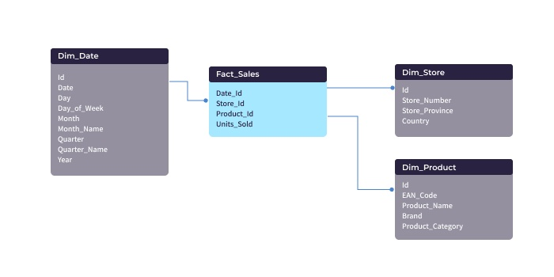
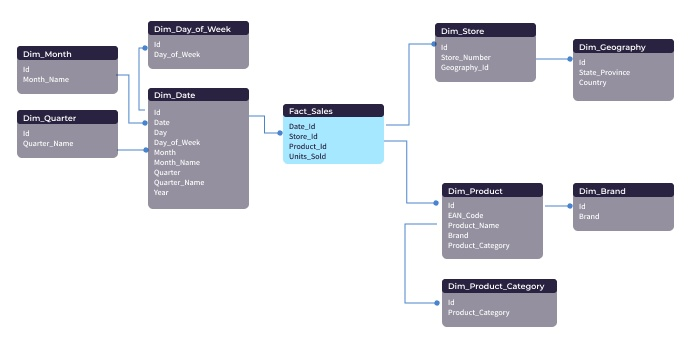

# DP-900 Microsoft Azure Data Fundamentals

- **Structured Data**: table-based source systems, csv files, relational databases, Web form results.

- **Unstructured Data**: key-value, pdf, word, jpeg.

- **Semi-structured Data**: json files, which may require flattening prior to loading into your source system

**OLTP(Online Transaction Processing)**: day2day operations

- リアルタイムトランザクション処理
- 応答ミリ秒単位
- リレーショナルデータベース
- Azure OLTP: Azure SQL Database, SQL Server in a VM, Azure Database for MySQL, Azure Database for PostgreSQL

**OLAP(Online Analytical Processing)**: reports and deep analysis

- データ分析
- 応答秒、分単位
- 多次元データベースまたはリレーショナルデータベース
- Azure OLAP: SQL Server with Columnstore indexes, Azure Analysis Services, SQL Server Analysis Services

**Data Lake**: store everything in its original, untransformed state.  
**Data warehouse**: store current and historical data in relational tables that are organized into a schema that optimizes performance for analytical queries.

**Star Schema**: 単純なクエリ、非正規化、設計保守簡単

**Snowflake Schema**: 複雑なクエリおよび集計、高度に正規化され、高いデータ整合性、設計保守複雑

**Azure Data Warehousing**

- SMP(Symmetric Multiprocessing)
  - Azure SQL Database
  - SQL Server in a VM
- MPP(Massively Parallel Processing)
  - Azure Synapse Analytics(SQL DW)
  - Apache Hive on HDInsight
  - Interactive Query (Hive LLAP) on HDInsight

**Relational Database**

- 複数表を関連つけて使う
- 複雑な検索、集計できる
- ACID
  - Atomicity(原子性): データベーストランザクションは、データベースに対する一連の操作をまとめたものです。原子性とは、一連の操作がすべて実行されるか、一つも実行されないかのどちらかとなることを保証します。
  - Consistency(一貫性): 一貫性は、データベーストランザクションの前後でデータベースが正当な状態の維持を保証する特性です。
  - Isolation(独立性): 複数のユーザーやシステムがデータベースに同時アクセスする場合、それぞれのトランザクションは独立して動作する必要があります。独立性は、実行中のトランザクションが他のトランザクションの途中結果に影響されないことを保証します。
  - Durability(永続性): トランザクションが一度完了したら、結果は恒久的にデータベースに保存されるべきです。
- Primary Key: データべーすのデータを一意に識別するための項目
  - 制約: 一意性、非 NULL
- Foreign Key: 他の表を参照するためのキー
  - 追加制約: 参照先に存在しない値は、参照元に追加できない
  - 削除制約: 参照元に存在する値は、参照先から削除できない
    - RISTRICT: 一切の削除を禁止する
    - CASCADE: 参照元から削除する＊
    - SET NULL: NULL 値を設定する
- Index: Primary Key is by default an index
  - B tree
  - Hash Index
  - BitMap Index
- View: SELECT の結果や複数テーブルの結合した結果を仮想テーブルとして作成する
- Normalization: データの重複をなくし整合的にデータを取り扱えるようにデータベースを設計する
  - First Normal Form: 繰り返し項目を持たない
  - Second Normal Form: 主キーに対してすべての非キー属性が完全関数従属
  - Third Normal Form: すべての非キー属性がどの候補キーに対しても推移的に関数従属していない
- DDL(Data Definition Language): create, alter, drop, truncate, comment, rename
- DML(Data Manipulation Language): select, insert, update, delete, lock table
- DCL(Data Control Language): grant, revoke
- TCL(Transaccional Control Language): commit, rollback

**Non-Relational Database**

- Any database that is not based on tables, rows and columns
- Type of Data: document(key:json), column-family DataTransfer

Document Data:

| Key | Document                      |
| --- | ----------------------------- |
| 101 | `json`                        |
|     | `   {`                        |
|     | ` "customerID": 99,`          |
|     | ` "OrderDate": "2023/03/22",` |
|     | `}`                           |

Column-Family Data:

| CustomerID | Column Faimil: Identity |
| ---------- | ----------------------- |
| 001        | First name: abc         |
|            | Last name: ade          |

Graph Data:

Time Series Data:

| timestamp               | deviceid | value |
| ----------------------- | -------- | ----- |
| 2023-03-22T09:00:00.123 | 1        | 90.0  |

Object Data - Blob Storage

| path                           | blob            | metadata                |
| ------------------------------ | --------------- | ----------------------- |
| /delays/2023/02/22/flights.csv | 0XAABBCCDDEE... | `{created: 2023-03-22}` |

**Azure Non-Relational Database**

- Cosmos DB

  - supports many data models (GraphHelpers, document, table, column-family)
  - compatible with established apis (Cassandra, MongoDB, getRSCModuleInformation, Etcd)
  - select the data consistency you need
  - 10 ms latency
  - SLA for throughput, latency, availability and consistency

- Table Storage

  - 5PB maximum limit

- Blob Storage

  - 5PB maximum limit
  - premium, hot, cool, archive access tiers

- File Storage
  - 5PB maximum limit
  - standard and premium

**Data Visualization**

- Paginated reports
  - designed to be printed and shared
  - formatted to fit well on a page or multiple pages
  - examples: invoice, sales detail report
- Interactive reports
  - designed to be viewed on screen
  - can click for more details, drill down
  - can change design/layout based on user action
- Dashboard
  - a mixture of chart types on a single page
  - click to go to the individual report

**Power BI**

- Typical workflow in powerbi
  1. connect to the data source
  2. pull data into the in-momory data model
  3. edit, transform the data
  4. build reports using power bi desktop
  5. share the report

The difference between [**Descriptive, Diagnostic, Predictive, Prescriptive, Cognitive**](https://demand-planning.com/2020/01/20/the-differences-between-descriptive-diagnostic-predictive-cognitive-analytics/)

1. Descriptive, to answer the question: What is happening?
2. Diagnostic, to answer the question: Why is happening?
3. Predictive, to answer the question: What will happen?
4. Prescriptive, to answer the question: What actions should we take?

[インデックスの仕組み](https://qiita.com/fuk101/items/2e6a225a97a14f0f2850)

Clusterd Index

- Clustered indexes sort and store the data rows in the table or view based on their key values.
- There can be only one clustered index per table, because the data rows themselves can be stored in only one order.

Nonclustered

- Nonclustered indexes have a structure separate from the data rows. A nonclustered index contains the nonclustered index key values and each key value entry has a pointer to the data row that contains the key value.
