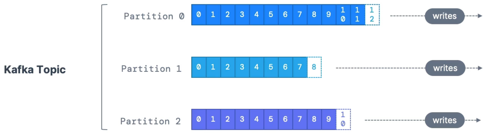
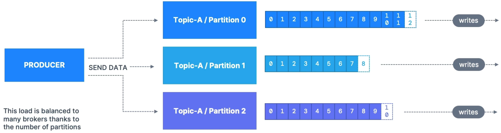
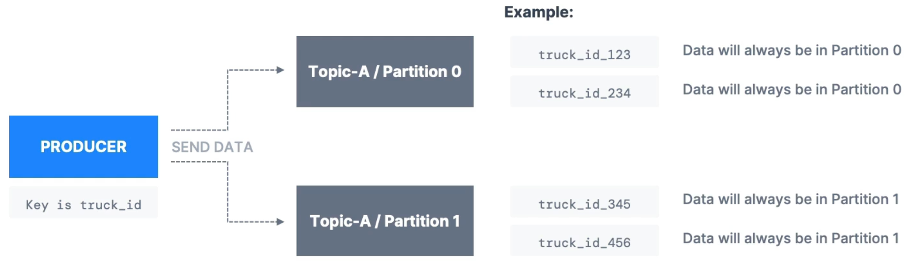
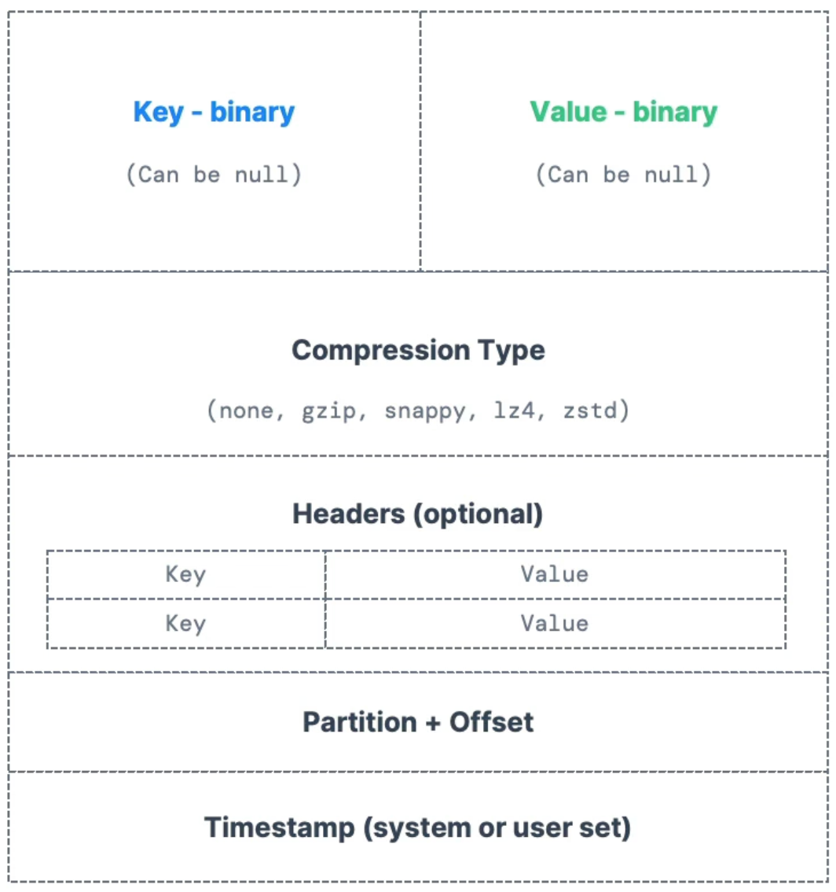
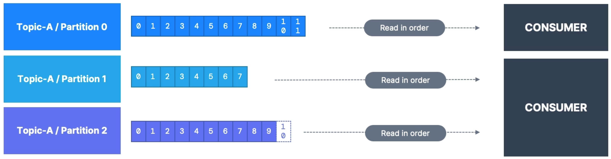

# Introduction to Apache Kafka

## Kafka Theroy

### Topics, Partitions and Offsets

> Topics: a particular stream of data

1.Identified by its name  
2.The sequence of messages is called a data stream  
3.Cannot query topics, instead, use Kafka Producers to send data andd Kafka Consumers to read the data

> Partitions and offsets

1.Topics are split in partitions  
2.Messages whitin each partition are ordered  
3.Each Message within a partition gets an incremental id, called offset

\*Important notes  
1.Kafka topics are immutable: Cannot be Delete or Update  
2.Data is kept only for a limited time (default is one week - configurable)  
3.Offset only have a meaning for a specific partition  
4.Offsets are not re-used even if previous messages have been deleted  
5.Order is guaranteed only within a partition (not across partitions)  
6.Data is assigned randomly to a partition unless a key is provided  
7.Can have as many partitions per topic as you want

### Producers and Message Keys

> Producers

1.Producers write data to topics(& Partitions)  
2.Producers know to which partition to write to (and which Kafka broker has it)  
3.Producers will automatically recover Kafka broker failures

> Producers: Message keys

1.Producers can choose to send a key with the message (string, number, binary, etc)  
2.If key=null, data is sent round robin (partition 0, 1, 2 ...)  
3.If key!=null, then all messages for that key will always goto the same partition (hashing)  
4.A key are typically sent if need message ordering for a specific field

> Kafka Messages Anatomy

> Kafka Message Serializer

1.Kafka only accepts bytes as an input from producers and sends bytes out as an output to consumers  
2.Kafka have a lot of message serializers.

- String (incl. JSON)
- int, Float
- Avro
- Protobuf  
  3.In the default Kafka partitioner, the keys are hashed using the murmur2 algorithm, with the formula below for the curious:
- targetPartition = Math.abs(Utils.murmur2(keyBytes)) % (numPartitions -1)

> Consumers & Deserialization

1.Consumers read data from a topic (identified by name) - pull model  
2.Consumers automatically know which broker to read from  
3.Consumers know how to recover broker failures  
4.Data is read in order from low to high offset within each partitions

