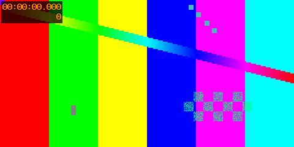
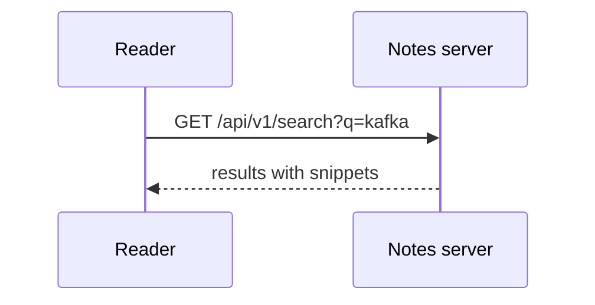

Use this page to check every feature. Each section says **what you should see**.

## Checklist

- [ ] **Sidebar**: "Feature tour" is highlighted (lilac background, purple bar on the left).
- [ ] **Calendar** (top left): October 11, 2026 is selected. October 5 shows two articles; September 30 shows one.
- [ ] **Search** (top center): press `/`, type `quokka` and `fox` as one word. Only "Hidden from the sidebar" appears; the draft, which contains the same word, never does.
- [ ] **Search in Japanese**: type `本語の` → this page appears.
- [ ] **Links**: [Deep article](nested/deeper/deep.md) opens without a page reload, and the sidebar expands three levels.
- [ ] **Draft**: [the draft](draft.md) shows "Article not found", and its sidebar entry is gone.
- [ ] **Every embed below renders**, with no edit controls.

## Markdown

Text with **bold**, _italic_, ~~strikethrough~~, `inline code`, an autolink https://example.com, and a footnote.[^1]

> A blockquote. 日本語のテキストも検索できます。

| Feature   | Syntax  | Status |
| --------- | ------- | ------ |
| Table     | GFM     | ✅     |
| Task list | `- [x]` | ✅     |
| Footnote  | `[^1]`  | ✅     |

1. Ordered item
2. Another item
   - Nested bullet

<span style="color:green">Green text</span> and <span style="color:red">red text</span> (inline HTML colors are kept; scripts are removed).

<script>alert('this script must never run')</script>

```go
package main

import "fmt"

func main() {
	fmt.Println("syntax highlighting and a Copy button")
}
```

```sql
SELECT id, title FROM articles WHERE date = '2026-10-11';
```



## Mermaid



## ECharts

```echarts
{
  "title": { "text": "Articles per month" },
  "tooltip": {},
  "xAxis": { "type": "category", "data": ["Jul", "Aug", "Sep", "Oct"] },
  "yAxis": { "type": "value" },
  "series": [{ "type": "bar", "data": [3, 5, 2, 6] }]
}
```

## draw.io

Two pages (use the page switcher), zoom, and no edit button:


## Excalidraw


## OpenAPI 3.1 (this site's own API)


## Swagger 2.0


There is no "Try it out" button.

## Video

An 8-second H.264 video. It must not autoplay; play it and drag the position bar to seek.


[^1]: The footnote text, linked back to its reference.
